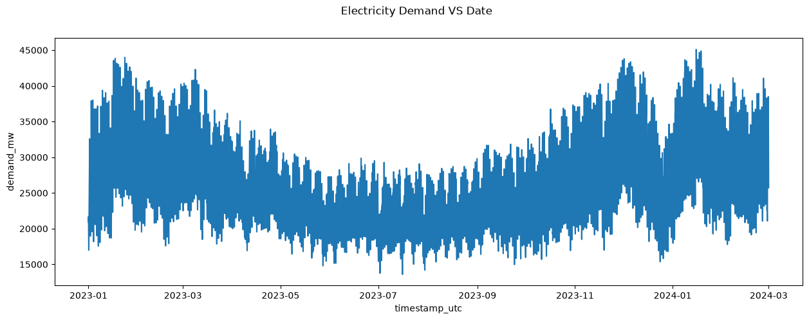
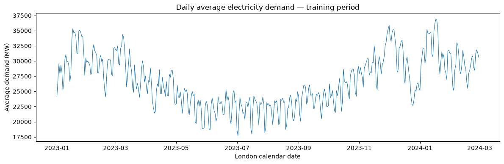
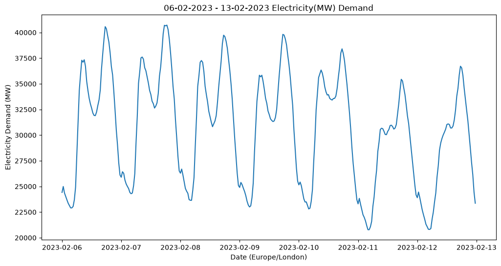
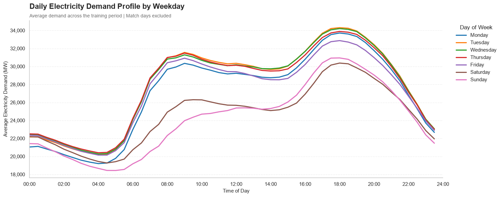
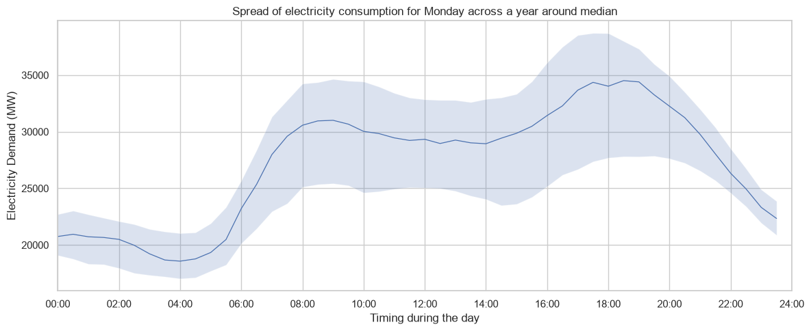
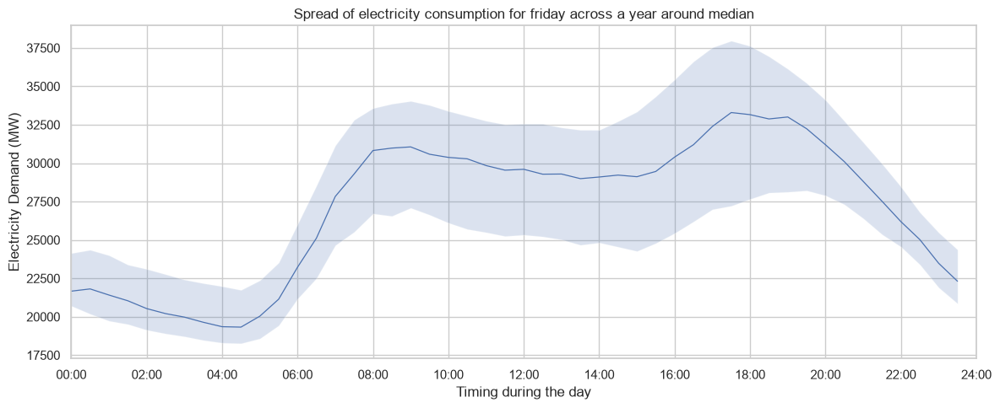
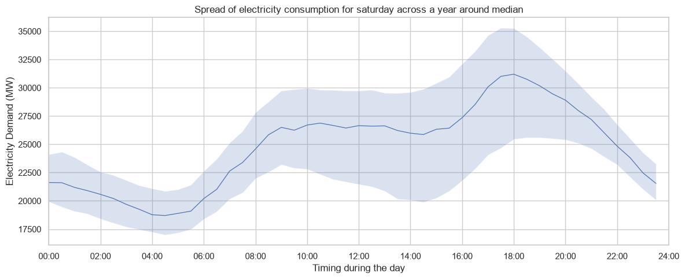
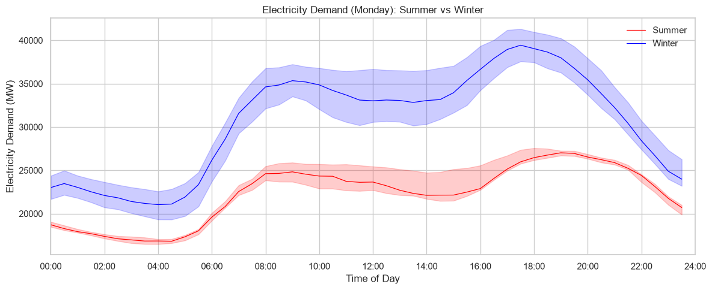

# Understanding ordinary electricity demand

An explanatory walkthrough of `notebooks/03_demand_eda.ipynb`  
Prepared: 23 October 2026  
Status: descriptive EDA completed to the winter–summer Monday comparison; no forecasting or football-effect results yet.

## Purpose and evidence

Before identifying an unusual halftime observation, we need to understand what makes electricity demand ordinarily rise, fall, and vary. This notebook investigates daily, weekly, and seasonal patterns, then asks how much an average profile conceals.

The figures below are exported directly from the saved [EDA notebook](../notebooks/03_demand_eda.ipynb). Repeated styling versions and the separate seasonal panels are omitted where a combined figure communicates the same result more clearly. Key numbers were independently recalculated from the finalized development data. The notebook's exploratory notes remain intact: initial observations and hypotheses are part of the learning record, not statements to overwrite retrospectively.

Data selection and definitions are documented in [the finalized dataset guide](../docs/finalized_dataset.md). This document explains analysis, rather than repeating the acquisition audit.

## 1. Establish what a row represents

Each row describes a half-hour interval in Great Britain's electricity system. Our outcome, `demand_mw`, is NESO forecast-performance `Demand_Outturn`. MW measures power; it is not a half-hour energy total in MWh or an instantaneous kettle-related peak.

This is a national network-demand measure, not household-only consumption. Commercial and industrial activity can contribute. Embedded generation—such as solar connected to distribution networks—can reduce the requirement observed by the transmission system even if users' consumption is unchanged. Consequently, a midday demand decline does not, by itself, establish reduced appliance use.

Two samples are used for different purposes:

| Sample | Definition | Observations |
|---|---|---:|
| `train` | All training rows, 1 January 2023–29 February 2024 | 20,400 half-hours |
| `baseline_train` | Training rows with inventoried England match days excluded | 19,922 half-hours across 415 dates |

The continuous training sample supports the overview and one-week plots. Match-day-excluded observations support ordinary-demand profiles. Exclusion does not guarantee that every remaining date is free from unusual weather, holidays, or other events. Validation and tournament outcomes are not used to construct these profiles.

## 2. Prepare and understand the time axis

CSV loading does not preserve timezone-aware pandas types. The notebook parses the cleaned UTC fields, then derives `timestamp_london` from `timestamp_utc` using `tz_convert('Europe/London')`.

- **UTC** identifies instants and supports ordering and elapsed-time calculations.
- **London time** identifies local clock hours and weekdays relevant to human routines.
- `timestamp_utc` labels the **interval start**. For example, 17:30 refers to the 17:30–18:00 interval, not an exact minute-level maximum.
- `settlement_date` identifies the London calendar day.

An important correction occurred during exploration: London timestamps were initially converted only in `train`, while `baseline_train` was later selected from `demand_data`, whose similarly named column still held UTC times. The conversion now occurs in the parent DataFrame before selecting subsets. All reported profile and spread results below use the corrected London clock.

This illustrates a general lesson: inspect the timezone of the actual DataFrame being analysed. A column name alone does not establish its timezone, and changing a copied subset does not update its parent.

## 3. Look at the full training series

**Question:** how does demand behave over the full development history?

The notebook plots every training half-hour against its UTC timestamp.

**What we observe:** demand levels are generally higher in the winter portions and lower around summer. Rapid rises and falls create a thick band, because individual daily patterns are compressed into a long horizontal time span.

**What this suggests:** demand's normal level depends on the time of year. A forecast that assumes the same typical level throughout the year is likely to omit useful structure.

**What it does not establish:** the winter-to-summer decline is not sufficient evidence of a permanent downward trend. The later rise suggests annual seasonality. Training contains roughly one complete annual cycle plus additional winter months, so the stability of that annual pattern across many years has not been established.

Trend and seasonality can coexist. A trend is a longer-term change in the underlying level; seasonality is a recurring calendar pattern. A descending segment alone cannot distinguish them.

## 4. Aggregate within each local day

**Question:** can we see slower variation more clearly by removing within-day detail?

The notebook groups `train` by `settlement_date` and calculates mean `demand_mw`. This produces one value per London calendar day.

**What we observe:** winter–summer differences become clearer. Repeated shorter dips remain visible, and a pronounced decline appears around late December.

**Interpretation:** weekly routines and holidays are plausible contributors to short dips; weather and seasonal conditions may also matter. These explanations have not been isolated by this plot.

**What aggregation changes:** the daily mean hides the morning and evening peaks. A day can have the same mean as another day but a different intraday shape. The plotted quantity remains average MW, not daily MWh. On a clock-change day, the mean uses that day's 46 or 50 equally long observations rather than assuming 48.

General approach: examine a time series at more than one scale. Aggregation reveals some features while hiding others.

## 5. Zoom in to one complete week

**Question:** what creates the short-run movement hidden inside the long-series band?

The selected week runs from **6 February 2023, 00:00 London**, inclusive, to **13 February, 00:00**, exclusive. It contains 336 half-hours and ends with the observation starting on 12 February at 23:30.

**What we observe:** a daily overnight trough, morning rise, and later peak repeat. Weekday curves have prominent morning and late-afternoon peaks; the weekend has lower levels and a weaker morning rise.

Checking the records refines visual estimates: weekday morning maxima within 05:00–11:59 occur at interval starts between 08:00 and 09:00. The largest observations within 15:00–22:59 start at 17:30 on Monday, Wednesday, Thursday and Friday, and 18:30 on Tuesday. These checked times revise the initial visual hypothesis of a 20:00–21:00 peak without erasing that original hypothesis.

The week alone cannot establish that every week behaves this way, nor can it identify individual activities causing the peaks. Domestic routines, workplace schedules, and lighting are hypotheses consistent with aggregate patterns, not measured mechanisms here.

**Boundary lesson:** the original filter excluded the starting midnight and included the following Monday midnight. Its row count was still 336. Using `[start, end)` fixed the selection. Correct counts do not automatically establish correct boundaries.

## 6. Ask whether daily shapes recur across many weeks

**Question:** is the February week representative of broader weekday patterns?

Using `baseline_train`, the notebook creates:

1. `weekday`: Monday = 0 through Sunday = 6, derived from London time.
2. `half_hour_slot`: `hour * 2 + minute // 30`, giving 0 through 47.
3. A mean and observation count for every weekday–slot combination: 336 groups.

For example, Monday at slot 17 pools observations starting at London 08:30 across eligible Mondays. It does not average all times within each Monday.

**What we observe:** the five working-day profiles have a steep morning rise, a lower or flatter midday section, and a larger late-afternoon/evening peak. Weekend morning demand rises less sharply, particularly on Sunday. All seven mean curves reach their maximum at the interval starting at 18:00 in this pooled sample.

**Interpretation:** both time of day and weekday contain useful information about ordinary demand. This motivates calendar features and a weekly seasonal benchmark. It does not prove any particular model will predict accurately.

**Important qualifications:**

- Holidays remain included; weekends are not synonymous with public holidays.
- Means combine different seasons, weather conditions and dates. Small differences between adjacent weekday curves are not automatically statistically meaningful.
- The peak of a mean profile is not the most frequent peak time of individual days. Those are different calculations.
- On spring clock changes, some local slots are absent; in autumn, repeated clock labels contribute twice to their slots. Counts should reveal this rather than forcing equal support.
- `settlement_period` counts consecutive elapsed intervals. It should not replace local clock slots for this comparison: 08:00 has different period numbers on ordinary, spring-transition, and autumn-transition days.

## 7. Examine what the average conceals

**Question:** do different Mondays have similar demand at the same clock time, or does the average hide considerable spread?

The notebook returns to individual Monday observations, rather than taking percentiles of already averaged data. At each slot it calculates the median, 25th percentile (Q1), 75th percentile (Q3), and count.

The **median** describes the centre. The **interquartile range**, `IQR = Q3 - Q1`, describes the width of the middle 50% of observations. Quartiles can be fractional because of interpolation between sample values.

The shaded region represents the observed middle 50% across Mondays at each clock position. It is not a confidence interval, a forecast prediction interval, or a boundary that marks anomalies. Approximately half the observations lie outside such a band by definition.

| Monday finding | London interval start | Q1 | Q3 | IQR |
|---|---|---:|---:|---:|
| Narrowest band | 23:00 | 21,947 MW | 24,892 MW | 2,945 MW |
| Widest band | 17:00 | 26,687.5 MW | 38,520.5 MW | 11,833 MW |

There are 59 eligible Monday dates. The broad afternoon band means that demand differs substantially **between Mondays at the same clock time**. It does not establish rapid fluctuations within individual Mondays or larger residual variance after a suitable model is fitted.

The initial visual impression of a narrow band near 06:00 was reasonable but did not locate its global minimum. Calculating `p75 - p25`, then using `idxmin()` and `idxmax()`, established the extrema. There is no 05:45 observation in these half-hour data; connecting plotted points does not create finer measurement resolution.

The median need not sit halfway between Q1 and Q3. Unequal distances can reflect asymmetry in the observed distribution. The whole median curve is also not necessarily an actual day that occurred.

## 8. Repeat the spread calculation for Friday and Saturday

The same median/quartile method was applied to eligible Fridays and Saturdays. These are completed extensions in the notebook; a separate Sunday spread plot has not yet been implemented, despite the exploratory section heading mentioning Sunday.

Friday retains a pronounced weekday-like morning rise and later peak. Saturday's morning rise is weaker and its daytime profile flatter, consistent with the seven-weekday mean comparison. Both have substantial between-day spread, especially around the later peak.

| Group | Eligible dates | Narrowest IQR | Widest IQR |
|---|---:|---|---|
| Friday | 57 | 3,400 MW at 22:30 | 10,746 MW at 17:30 |
| Saturday | 59 | 3,183 MW at 23:30 | 10,604.5 MW at 17:30 |

These supporting figures have different automatic vertical limits. Compare numeric widths or use common limits when making visual cross-day comparisons. They are descriptive replication of the method, not independent experiments proving weekday effects.

## 9. Investigate seasonal mixing as a source of spread

**Question:** is the pooled Monday band wide partly because it combines different seasonal demand regimes?

The notebook copies the eligible Mondays and labels months using London time:

- Winter: December, January, February.
- Summer: June, July, August.
- Other months are omitted only from this comparison.

It counts distinct dates, then calculates medians, Q1, Q3 and counts for each season–slot group. There are 96 groups: two seasons × 48 clock positions.

| Season | Eligible Mondays | Interpretation of support |
|---|---:|---|
| Summer | 12 | One summer within training, with match-day exclusions |
| Winter | 22 | January–February 2023, December 2023, and January–February 2024 |

The categories describe calendar months, not observed warm/cold conditions. Winter observations do not form a single complete December-to-February season.

### Demand level differs

The winter median is above the summer median throughout the day in this sample. At the interval starting at 17:00, the medians are 38,947.5 MW in winter and 25,143 MW in summer. Weather, lighting, holidays, and embedded generation are plausible contributors, but this chart does not isolate them.

### Daily shape differs

The winter median profile peaks at 17:30, at 39,440 MW. Summer has a flatter, later maximum at 19:00, at 27,021.5 MW, and a more evident afternoon dip. Both retain an overnight low and morning rise.

This suggests that a constant winter uplift may be insufficient to describe the seasonal difference: the intraday shape changes as well as the level. It is a modelling implication to evaluate, not a fitted-model conclusion.

### Within-season bands are narrower at the previously widest pooled slot

| Monday group at 17:00 | Median | Q1 | Q3 | IQR |
|---|---:|---:|---:|---:|
| All eligible Mondays | 33,668 MW | 26,687.5 MW | 38,520.5 MW | 11,833 MW |
| Summer | 25,143 MW | 24,956.25 MW | 26,703.5 MW | 1,747.25 MW |
| Winter | 38,947.5 MW | 36,895.75 MW | 41,195.5 MW | 4,299.75 MW |

Separating seasons reveals more consistent groups at this time. This supports the hypothesis that seasonal mixing contributes to the wide pooled afternoon band.

It does **not** quantify a causal seasonal effect or a percentage of variance explained. IQRs do not decompose additively, and the pooled group also contains spring and autumn. The narrower summer band describes its observations; having fewer Mondays does not itself imply a more precisely estimated distribution.

Winter still varies appreciably. Calendar season leaves differences in temperature, weather, holidays, year, and other factors unresolved. We have not adjusted for these conditions or tested significance. Bands are pointwise summaries, not a region within which 50% of complete daily curves must lie.

## 10. Keep the hypothesis trail

| Initial idea or question | What later analysis adds | What remains unresolved |
|---|---|---|
| Weekday morning demand rises around 08:00–09:00 | The selected week and broader profiles support a morning rise | Relative contributions of households, workplaces, and other users |
| Larger peak might be around 20:00–21:00 | The checked February week peaks earlier; pooled weekday means peak at 18:00 | Distribution of individual-day peak times and its determinants |
| People leaving home might explain a midday dip | Demand is broader than households; summer has a visible afternoon dip | Whether activity, embedded generation, weather, or other factors explain it |
| Weekends are lower because people go out | Broader profiles support lower weekend daytime demand | Specific activities and causal mechanisms are not measured |
| Small bump near midnight might be a technical feature | It remains a question worth targeted inspection | No technical fault or behavioural cause has been established |
| Monday spread may be widest in the early evening | Corrected IQR calculation locates its maximum at 17:00 | How much spread remains after a properly specified model |
| Seasonal pooling may contribute to spread | Winter/summer grouping produces narrower bands at 17:00 | Formal explanatory contribution and robustness across years |

Exploration should preserve this progression: a visible feature leads to a hypothesis; a calculation or comparison refines it; uncertainty remains where evidence is insufficient.

## 11. What the EDA establishes—and its limits

The training sample has substantial daily structure, weekday differences, and seasonal differences. An unconditional average cannot represent all of these features well. Between-day spread is also large enough that judging a match observation against a single average would be inadequate.

These are sample-based descriptions. This notebook has not yet established stationarity, measured autocorrelation, performed spectral analysis, fitted a forecasting model, evaluated forecasts, tested ARCH effects, or estimated football-related excess demand. It does not show that a match caused any change.

Model errors are different from the raw spread plotted here. A suitable seasonal model may remove some predictable variation. Only after modelling and diagnostic checks can we examine what remains unexplained.

## 12. Connection to the course and next milestone

| Course area | Connection to work completed | Later application |
|---|---|---|
| M1: stationarity, ARIMA/SARIMA, ADF/PP | Levels and calendar patterns change; transformation and deterministic seasonality need thought | Examine dependence and stability, then fit a limited interpretable model |
| M2: VAR/cointegration | No suitable multivariate relationship has been established merely by including temperature | Conditional extension only if assumptions and purpose justify it |
| M3: structural stability | Recurring calendar changes differ conceptually from a persistent parameter break | Diagnose stability if warranted; do not call every temporary disturbance a break |
| M4: ARCH/GARCH | Raw between-day IQR is not evidence of ARCH in model residuals | Test residual conditional heteroskedasticity before considering volatility models |
| M5: spectra | Recurring daily/weekly shapes motivate frequency-domain investigation | Use a periodogram to assess periodic components, with appropriate interpretation |

The next milestone is **autocorrelation**, followed by a **seasonal naïve forecasting benchmark**. Profiles group by calendar labels; autocorrelation examines a series in chronological order and its relationship to earlier values. A weekly naïve rule then provides a simple reference against which a learned model must earn its complexity.

For dependence calculations, use the complete, ordered training timeline. Do not remove match days and then treat adjacent remaining rows as consecutive half-hours. In a regular UTC sequence, 48 and 336 observations correspond to 24 and 168 elapsed hours; near DST, those lags do not always mean the same London clock time on the preceding day or week. This distinction must be stated in the next analysis.

We will keep validation and tournament outcomes separate, use only information available at the forecast issue time for operational claims, and avoid choosing a model based on the seven event outcomes. The student will perform and interpret the next calculations with guidance.
