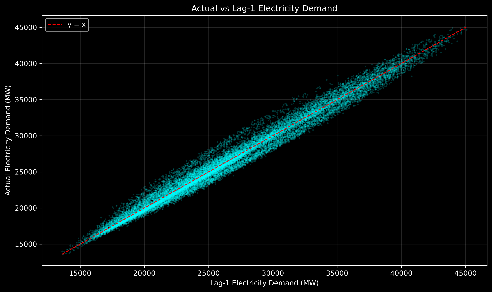
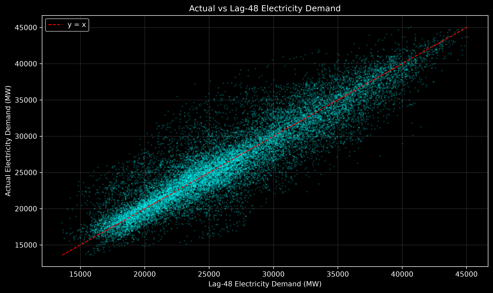
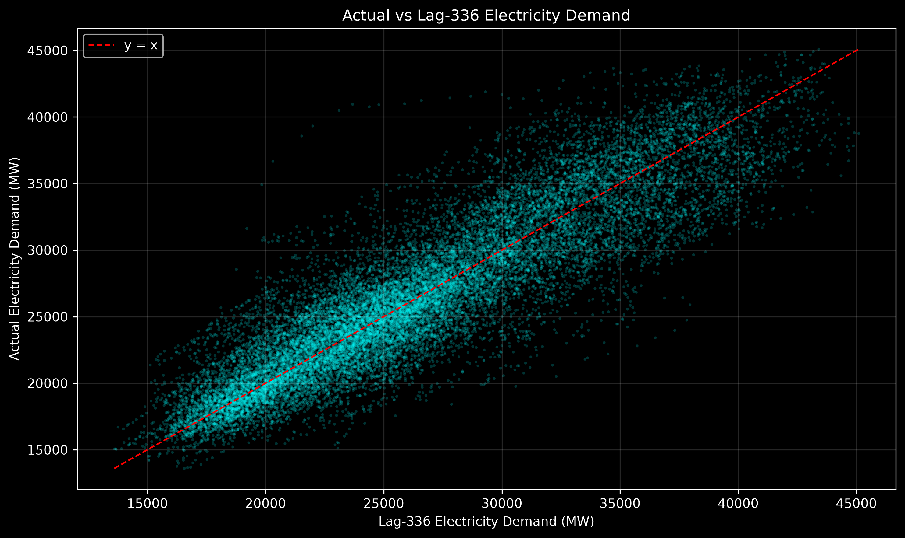
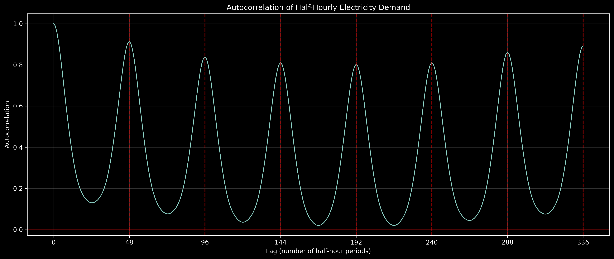
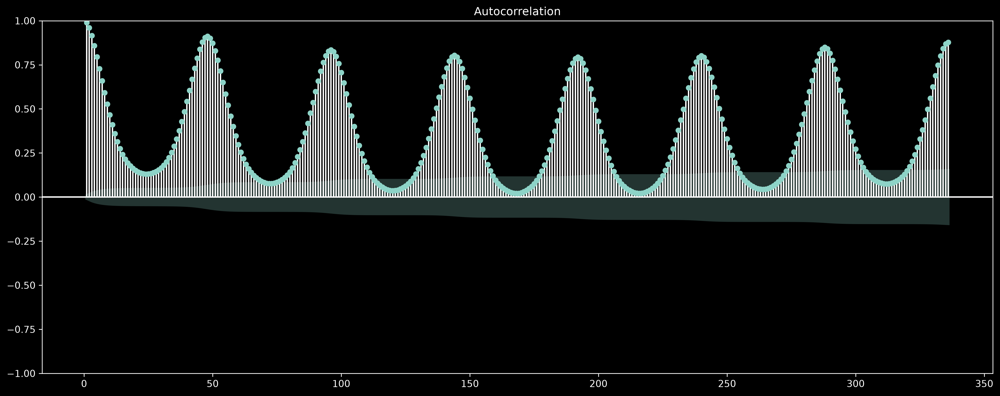
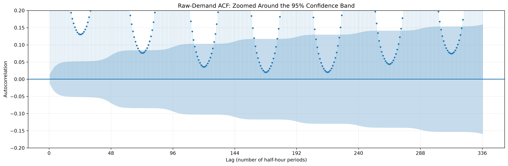
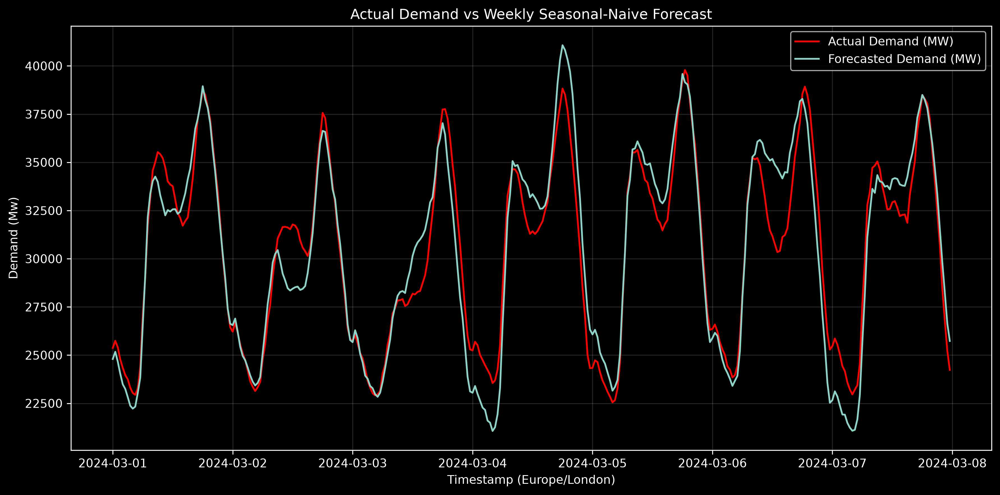

# Autocorrelation and the weekly seasonal-naive benchmark

An explanatory walkthrough of `notebooks/04_autocorrelation_and_baselines.ipynb`  
Prepared: 26 October 2026  
Status: raw-demand autocorrelation and the first validation benchmark completed; stationarity analysis and statistical modelling have not yet been performed.

## Purpose and evidence

The preceding [demand EDA](01_demand_eda_analysis.md) showed recurring intraday, weekday and seasonal patterns. This notebook changes the question from *what does the average calendar profile look like?* to *how strongly is current demand related to its earlier values?* It then turns the observed weekly repetition into the project's first genuine out-of-sample forecasting benchmark.

The figures below reproduce the saved notebook calculations from the finalized development data and are rendered at 300 DPI for the report. The reported numbers were independently recalculated. The notebook's initial observations remain part of the learning record; this report distinguishes those visual impressions from the numerical checks that followed.

The data contract and chronological split are documented in [the finalized dataset guide](../docs/finalized_dataset.md). This analysis does not open the Euro 2024 event holdout.

## 1. Preserve a genuine half-hourly sequence

Autocorrelation only has a meaningful lag interpretation when observations remain in their true chronological order. The notebook therefore uses all rows in the `train` split, sorts them by `timestamp_utc`, and confirms:

| Training check | Result |
|---|---:|
| Observations | 20,400 |
| First interval start | 1 January 2023, 00:00 UTC |
| Last interval start | 29 February 2024, 23:30 UTC |
| Consecutive 30-minute differences | 20,399 |
| Duplicate or irregular UTC intervals | 0 |
| Missing `demand_mw` values | 0 |

The match-day-excluded `baseline_fit_eligible` subset is deliberately **not** used for these lag calculations. Removing complete match days and then shifting by a row count would make adjacent retained rows appear 30 minutes apart when they may actually be more than a day apart.

The lags in this notebook use the regular UTC sequence:

| Lag | Elapsed time represented |
|---:|---:|
| 1 | 30 minutes |
| 48 | 24 hours |
| 336 | 168 hours, or 7 days |

Near a daylight-saving transition, 24 or 168 elapsed hours do not always map to the same London clock label. This matters later when interpreting a calendar-time forecasting rule.

## 2. Understand what a lagged relationship means

For demand value \(y_t\), lag \(k\) is the earlier observation \(y_{t-k}\). The notebook first examines selected lags with scatterplots. The horizontal axis contains past demand and the vertical axis contains current demand. The dashed line is \(y=x\):

- A point on the line means current demand equals demand at that earlier time.
- A point above the line means current demand is higher.
- A point below the line means current demand is lower.

### Lag 1: 30-minute persistence

The points form a narrow rising band and the Pearson correlation is **0.9892**, using 20,399 valid pairs. Demand ordinarily changes gradually from one half-hour to the next, so the latest observation contains considerable information about the next observation.

This is strong persistence, not 98.9% forecast accuracy. Correlation does not measure the size of errors around \(y=x\), and a high correlation can coexist with systematic bias or large errors at particular times.

Lag 1 is also unavailable for the project's day-ahead use case. When a forecast is issued today for tomorrow evening, tomorrow's immediately preceding half-hour has not happened. A model may recursively use its own earlier predictions, but it cannot use future realized demand without leaking information.

### Lag 48: the same elapsed time one day earlier

Lag 48 has correlation **0.9142**, using 20,352 valid pairs. The relationship is still strong because a similar daily shape often repeats, but the cloud is broader than for lag 1. Day-to-day weather, weekday changes, holidays, seasonal level and other conditions prevent yesterday from being an exact copy of today.

A whole-day-ahead operational warning remains important: for a forecast issued at 10:00 today, today's evening demand is not yet known. Therefore, lag 48 cannot be used directly as an observed predictor for every target interval tomorrow.

### Lag 336: the same elapsed time one week earlier

Lag 336 has correlation **0.8926**, using 20,064 valid pairs. It is slightly less correlated than lag 48, but it normally aligns both clock phase and weekday. More importantly, an observation from one week earlier is available when a day-ahead forecast is issued.

This combination—strong relationship, same weekday, and genuine information availability—motivates the weekly seasonal-naive benchmark.

| Comparison | Valid pairs | Pearson correlation |
|---|---:|---:|
| Current demand vs lag 1 | 20,399 | 0.9892 |
| Current demand vs lag 48 | 20,352 | 0.9142 |
| Current demand vs lag 336 | 20,064 | 0.8926 |

These correlations describe dependence in the raw training data. They are not causal effects and do not establish which predictor will minimize out-of-sample error.

## 3. Examine every lag across one week

Selected lags can confirm expectations while hiding the shape between them. The notebook therefore calculates the Pearson correlation between \(y_t\) and \(y_{t-k}\) at every lag from 0 through 336.

The curve oscillates rather than declining smoothly. Peaks occur approximately every 48 half-hours, showing that observations at the same phase of the daily cycle are similar. Valleys occur between daily peaks, where the lag can compare different parts of the daily demand cycle.

| Lag | Interpretation | Pairwise correlation |
|---:|---|---:|
| 0 | Same observation | 1.0000 |
| 1 | 30 minutes | 0.9892 |
| 2 | 1 hour | 0.9601 |
| 48 | 1 day | 0.9142 |
| 96 | 2 days | 0.8387 |
| 144 | 3 days | 0.8104 |
| 192 | 4 days | 0.8029 |
| 240 | 5 days | 0.8112 |
| 288 | 6 days | 0.8615 |
| 336 | 7 days | 0.8926 |

The whole-day peak correlations decrease through lag 192 and then rise again toward lag 336. This is consistent with weekly structure: after moving through different weekday combinations, a seven-day lag realigns the same weekday. It does not mean that seasonality is the only cause of the correlations.

All pairwise correlations through lag 336 are positive. The minimum is approximately **0.0202 at lag 168**, corresponding to 84 elapsed hours or 3.5 days. A value near zero is qualitatively different from the prominent daily peaks, even if a very large sample can make small estimates statistically detectable.

## 4. Add a formal ACF and confidence band

The notebook's first curve uses Pandas Pearson correlations, recalculating the overlapping pair sample at each lag. A formal autocorrelation function (ACF) is then produced with Statsmodels. Its numerical estimates differ slightly because the estimators use different normalization conventions, but both show the same substantive structure.

The formal ACF again shows:

- Very strong short-lag persistence.
- Repeating daily peaks at multiples of 48.
- A prominent weekly peak at lag 336.
- Broad valleys between the daily peaks.

The shaded region is an approximate **95% confidence band for autocorrelation around zero**, using the raw-data Bartlett calculation. A stem outside the band provides evidence against zero autocorrelation at that lag under the approximation used. It is not a forecast interval for demand and does not describe uncertainty around a future MW value.

The zoom deliberately clips large autocorrelations so that the confidence band can be inspected. An independent calculation finds that **244 of the 336 displayed nonzero lags** lie outside the approximate band. Several valleys fall inside it, while the daily and weekly peaks are far outside.

This large number of significant lags must not be converted mechanically into hundreds of autoregressive terms:

1. Raw demand contains deterministic daily, weekly and longer seasonal structure.
2. The sample is large, so modest correlations can be statistically detectable.
3. Adjacent lag tests are themselves strongly related, and viewing hundreds creates a multiple-comparison issue.
4. Raw-series significance does not establish stationarity or optimal forecasting order.

The most useful later ACF will be the ACF of a transformed series and, ultimately, of fitted-model residuals. If residual correlations remain outside the confidence band, the model has left predictable temporal structure unexplained.

## 5. Define a leakage-safe weekly seasonal-naive forecast

The first benchmark is:

$$
\widehat y_t = y_{t-336}.
$$

It predicts each half-hour using actual demand exactly 336 observations earlier. This rule has no estimated coefficients. Its purpose is to set a meaningful minimum standard: a more complex model should improve on an already strong weekly repetition rule.

The notebook correctly performs the shift on the **complete, sorted development timeline before selecting validation rows**. If validation were selected first, its initial 336 observations would incorrectly lack access to the end of training.

The alignment check is:

| Item | Value |
|---|---|
| First validation target | 1 March 2024, 00:00 UTC |
| Actual target demand | 25,373 MW |
| Forecast source | 23 February 2024, 00:00 UTC |
| Source demand and forecast | 24,799 MW |
| Elapsed separation | Exactly 7 days |

All **4,414 validation rows** receive a forecast, with no missing forecast values. The validation length is not a multiple of 48 because it includes the March spring clock-change day with 46 London settlement periods. The underlying UTC sequence remains regular.

The benchmark uses information genuinely available well before the target. Nevertheless, a fixed 336-row UTC shift is misaligned by one London clock hour during the week surrounding the spring DST transition. This should be retained as a known limitation or handled explicitly in a later calendar-time model.

## 6. Define forecast errors and validation metrics

The signed error convention is:

$$
e_t = y_t-\widehat y_t.
$$

- Positive error: actual demand exceeded the forecast, so the model underforecasted.
- Negative error: actual demand was below the forecast, so the model overforecasted.

Three validation metrics are calculated:

$$
\text{ME}=\frac{1}{n}\sum e_t,
\qquad
\text{MAE}=\frac{1}{n}\sum |e_t|,
\qquad
\text{RMSE}=\sqrt{\frac{1}{n}\sum e_t^2}.
$$

| Benchmark | Validation rows | Mean error | MAE | RMSE |
|---|---:|---:|---:|---:|
| Weekly seasonal naive | 4,414 | -646.37 MW | 1,946.17 MW | 2,541.24 MW |

The negative mean error means that, averaged over validation, the benchmark forecast is approximately **646 MW higher than actual demand**. This is an average bias, not a claim that every interval is overforecasted.

MAE says that the typical absolute error is about **1.95 GW**. RMSE is larger, at about **2.54 GW**, because squaring places more weight on large misses. These values cannot yet be labelled good or bad in isolation. They become meaningful when compared on identical timestamps with the statistical model and the issued NESO forecast.

The complete validation score includes the two inventoried March 2024 England friendly match days: 96 of 4,414 rows. Later reporting should distinguish ordinary and event windows, while avoiding model choices based on the protected Euro 2024 outcomes.

## 7. Inspect one validation week instead of relying only on averages

Overall metrics hide when and how a method fails. The notebook therefore plots the first full validation week, from 1 March 00:00 through 8 March 00:00 London time, using an inclusive start and exclusive end.

The benchmark reproduces the broad daily rhythm well: overnight troughs, morning rises and later peaks occur in approximately the right places. Daily actual maxima in this week occur at 18:00 or 18:30, while forecast maxima usually occur at 18:00. This demonstrates strong timing information, not exact peak magnitude prediction.

The initial visual inspection correctly identified 4 and 6 March as days with notable disagreement. It also suggested that forecasts generally exceeded peaks, fell below troughs, and had their largest errors near midnight. The notebook preserves those initial impressions, then tests them numerically rather than silently rewriting them.

## 8. Verify the visual impressions numerically

Daily mean error shows direction, while daily MAE shows typical magnitude:

| Local date | Observations | Mean error | Daily MAE |
|---|---:|---:|---:|
| 1 March | 48 | 299.1 MW | 744.0 MW |
| 2 March | 48 | 574.0 MW | 892.3 MW |
| 3 March | 48 | 66.1 MW | 1,124.5 MW |
| 4 March | 48 | -404.9 MW | 1,823.5 MW |
| 5 March | 48 | -571.9 MW | 787.9 MW |
| 6 March | 48 | -349.7 MW | 1,650.9 MW |
| 7 March | 48 | 218.1 MW | 1,367.9 MW |

The daily MAE confirms that **4 March** has the greatest typical error in the selected week, followed by **6 March**. The mean-error sign changes: the benchmark underforecasts on 1–3 and 7 March, but overforecasts on 4–6 March. Therefore, this week does not support a universal rule that the weekly method always overpredicts peaks and underpredicts troughs.

The ten largest individual errors provide a more precise location check:

| London timestamp | Actual | Forecast | Signed error | Absolute error |
|---|---:|---:|---:|---:|
| 6 Mar 13:00 | 30,346 | 34,687 | -4,341 | 4,341 |
| 6 Mar 12:30 | 30,752 | 34,870 | -4,118 | 4,118 |
| 6 Mar 13:30 | 30,408 | 34,414 | -4,006 | 4,006 |
| 6 Mar 12:00 | 31,175 | 35,173 | -3,998 | 3,998 |
| 6 Mar 11:30 | 31,468 | 35,092 | -3,624 | 3,624 |
| 4 Mar 20:00 | 35,173 | 38,553 | -3,380 | 3,380 |
| 2 Mar 12:00 | 31,776 | 28,447 | 3,329 | 3,329 |
| 6 Mar 14:30 | 31,231 | 34,492 | -3,261 | 3,261 |
| 4 Mar 19:30 | 36,458 | 39,706 | -3,248 | 3,248 |
| 2 Mar 12:30 | 31,721 | 28,521 | 3,200 | 3,200 |

The largest pointwise misses cluster around midday on 6 March, the evening of 4 March and midday on 2 March—not around midnight. This is a useful methodological lesson: a full-week plot compresses 336 observations, so perceived gaps should be checked with calculated errors.

This one week is illustrative. It should not replace the complete validation metrics or be selected because it makes the benchmark look particularly strong or weak.

## 9. What this notebook establishes

The notebook provides strong descriptive evidence that raw half-hourly demand has:

- Very high short-run persistence.
- A repeated 48-half-hour daily cycle.
- Additional weekly structure, with a strong lag-336 relationship.
- Enough week-to-week similarity for a simple weekly rule to reproduce broad demand shape.
- Meaningful remaining forecast errors whose size, direction and timing vary.

It also establishes a reproducible, leakage-checked benchmark score on the validation period. Future models must be assessed on the same timestamps and error definitions.

## 10. What it does not establish

This notebook does not yet show that:

- Raw demand is stationary.
- A particular AR or MA order is appropriate.
- Every statistically significant lag should enter a model.
- High correlation implies accurate forecasts or causation.
- The weekly benchmark is competitive with NESO or a fitted seasonal model.
- Forecast errors are independent, normally distributed or homoskedastic.
- Any error is caused by football.
- A half-hourly model can recover an instantaneous television-pickup spike.

The weekly rule is an event-blind counterfactual candidate, not yet the final counterfactual. Its errors contain predictable calendar, seasonal, weather and exceptional-event effects that a better model may capture.

## 11. Connection to the course and next milestone

| Course area | Connection to this notebook | Next use |
|---|---|---|
| M1: ARIMA/SARIMA and stationarity | Raw ACF has persistent, repeating dependence; a seasonal-naive baseline is established | Examine transformations, ADF/PP evidence, then fit a limited seasonal model |
| M3: interventions and structural stability | Temporary forecast errors are not automatically structural breaks | Keep short match interventions conceptually separate from persistent parameter change |
| M4: ARCH/GARCH | Changing raw forecast-error size is not sufficient evidence of ARCH | Test conditional heteroskedasticity on fitted-model residuals |
| M5: spectral analysis | ACF peaks suggest daily and weekly periodicity in the time domain | Verify dominant frequencies with a periodogram |

The next notebook should examine stationarity and spectral structure. It will compare raw demand with first, daily-seasonal and weekly-seasonal differences, use formal ADF and Phillips–Perron tests with stated deterministic terms, and connect time-domain ACF patterns to periodogram peaks. The raw ACF should then be compared with transformed-series ACFs rather than treated as a final model-order decision.
