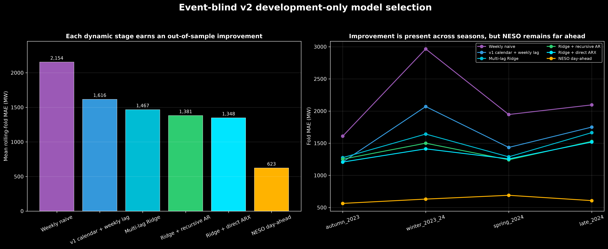
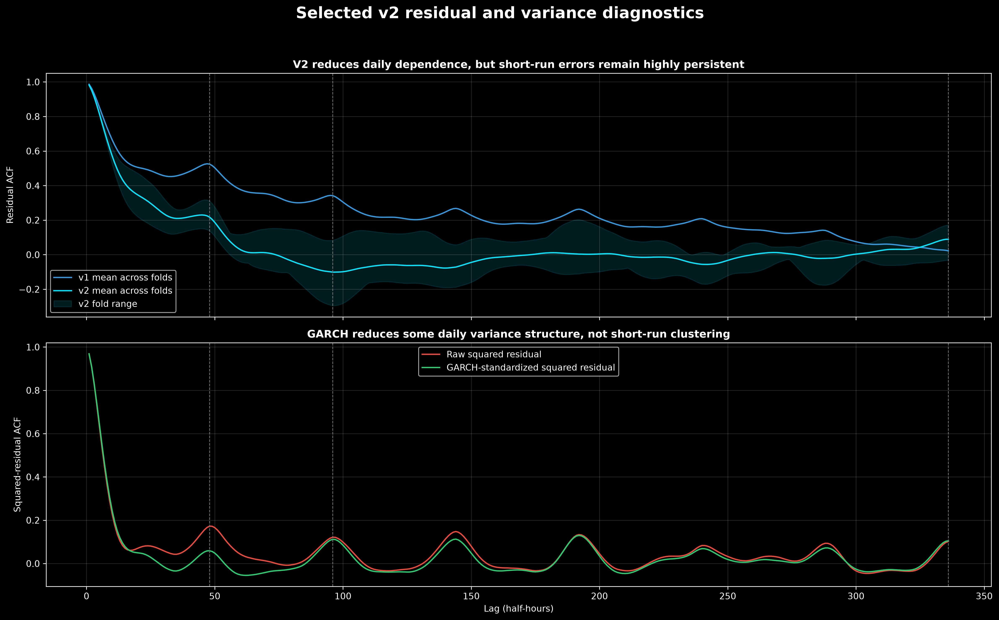
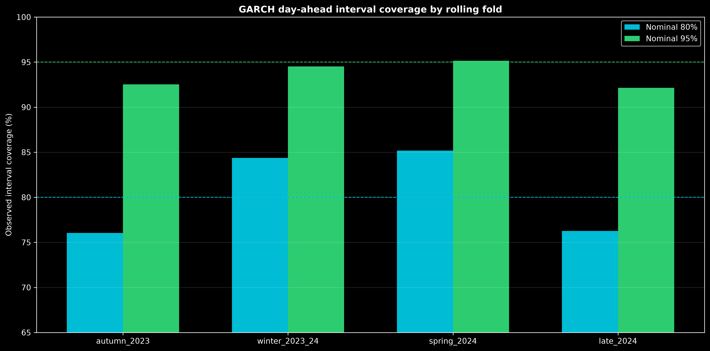

# Event-blind v2 — development model selection

Status: point and variance specifications locked before final test

Final test opened: **no**

## What was compared

All candidates were evaluated on the same four rolling-origin day-ahead folds. Every
input was required to exist at the previous-day 10:00 London cutoff. January–March 2025
was not read for fitting, selection or diagnostics.

| Stage | Purpose |
|---|---|
| Weekly seasonal naive | Minimum benchmark using lag 336 |
| V1 calendar + weekly lag | Reproduce the earlier event-blind approach |
| Multi-lag Ridge | Add safe daily/weekly lags, Fourier terms and regularization |
| Recursive AR errors | Forecast residuals recursively from the cutoff |
| Direct residual ARX | Optimize each day-ahead horizon from safe residual history |
| GARCH(1,1) | Forecast conditional variance; point forecast unchanged |
| NESO day-ahead | External operational comparator, never an input |

## Mean-model results

| Model | Mean fold MAE | Mean fold RMSE | Worst fold MAE |
|---|---:|---:|---:|
| Weekly seasonal naive | 2,154 MW | 2,745 MW | 2,966 MW |
| V1 calendar + weekly lag | 1,616 MW | 2,065 MW | 2,070 MW |
| Multi-lag Ridge | 1,467 MW | 1,894 MW | 1,664 MW |
| Ridge + recursive AR(1,2,48,96) errors | 1,381 MW | 1,787 MW | 1,529 MW |
| **Ridge + direct cutoff-safe residual ARX** | **1,348 MW** | **1,746 MW** | **1,518 MW** |
| NESO day-ahead | 623 MW | 822 MW | 690 MW |

The selected v2 point forecast reduces mean fold MAE by approximately 17% relative to
the v1 model and 37% relative to the weekly naive benchmark. NESO remains far more
accurate, showing that archived ex-ante weather and richer operational inputs remain the
largest missing ingredients.

## Why the selected model works better

### Base: recent two-year multi-lag Ridge

The base model contains:

- 336 local half-hour-of-week effects;
- slot-specific annual sine and cosine terms;
- additional annual Fourier harmonics;
- bank holiday and trend;
- safe daily demand lags 96, 144, 192, 240 and 288;
- weekly demand lags 336, 672, 1008 and 1344;
- recent daily/weekly means, spreads and changes.

Ridge regularization stabilizes correlated lag coefficients. Level demand beat log
demand, and a recent 730-day window beat expanding history. This is evidence of changing
demand regimes and supports a rolling/recent training policy.

### Direct residual correction

The second layer predicts the base residual directly at each delivery horizon from:

- residual lags 96–672;
- latest residual known at the cutoff;
- residual means over the preceding 6, 12, 24 and 48 hours;
- recent residual variability;
- forecast horizon, clock Fourier terms and weekday.

This model is an ARX-style direct multi-step forecast. It outperforms fitting one-step AR
coefficients and recursively carrying them 14–38 hours into the future.

## SARIMAX feasibility result

A daily SARIMAX residual specification `(2,0,1) × (1,0,1,48)` was fitted on the latest
730-day training window as a pre-specified feasibility check. One fit took approximately
80 seconds, reached the 30-iteration limit without convergence and returned large,
partly cancelling AR coefficients. It was rejected before final testing.

This does not mean SARIMAX is universally unsuitable. It means this period-48 likelihood
specification is poorly conditioned for the present long, strongly persistent half-hourly
series and is not a reliable candidate without a much larger estimation study.

## Residual status

V2 reduces daily residual dependence but does not produce white noise. Across folds,
lag-1 ACF remains approximately 0.98. Successive half-hours within a delivery day share
unobserved weather and system shocks, so high within-day correlation remains even when
the previous-day conditional mean is improved.

This distinction matters:

- one-step residual independence is not equivalent to good 14–38-hour forecasts;
- making a model use tomorrow's earlier actual residuals would reduce ACF but leak
  information unavailable at the day-ahead cutoff;
- forecast evaluation and uncertainty must continue to respect daily/event clusters.

## GARCH result

One Gaussian GARCH(1,1) model was fitted per training fold. All fits converged. Average
variance persistence `α + β` is 0.980, confirming slowly decaying volatility regimes.

| Interval | Nominal coverage | Mean observed coverage |
|---|---:|---:|
| Central interval | 80% | 80.5% |
| Central interval | 95% | 93.6% |

GARCH gives useful approximate forecast intervals and reduces some daily squared-error
dependence. It does not eliminate short-run squared-residual dependence, and ARCH-LM
still rejects after standardization in every fold. Therefore GARCH is retained as an
uncertainty layer with explicit limitations; it does not alter the point forecast.

## Locked decision

Before opening January–March 2025, the specification is locked as:

1. fit the level-demand multi-lag Ridge on the most recent 730 days with `alpha=0.1`;
2. fit the direct cutoff-safe residual correction with no material Ridge penalty;
3. use Gaussian GARCH(1,1) for conditional forecast variance only;
4. compare the untouched final test with weekly naive, v1 and NESO;
5. report MAE, RMSE, bias, fold/day stability, ACF, Ljung–Box, ARCH-LM and interval
   coverage without retuning.

The lock is machine-readable in `configs/event_blind_v2_model_lock.json`.
