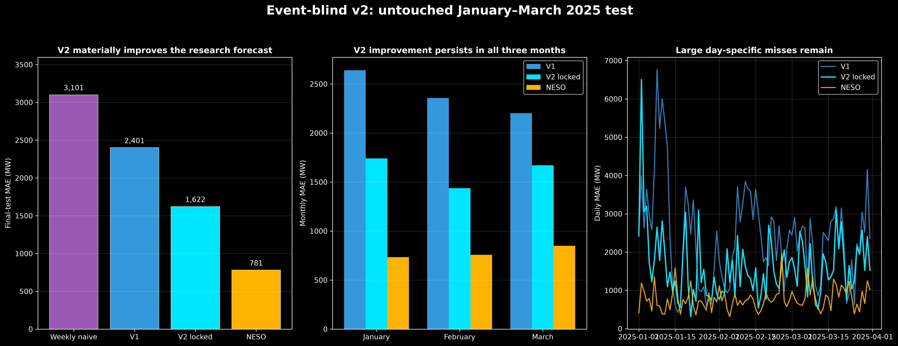
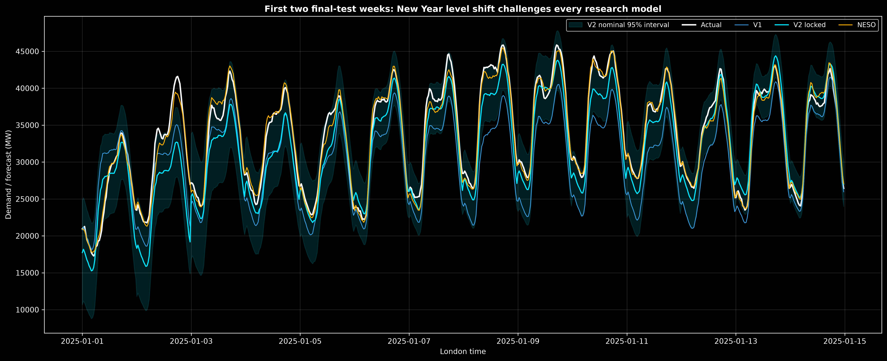
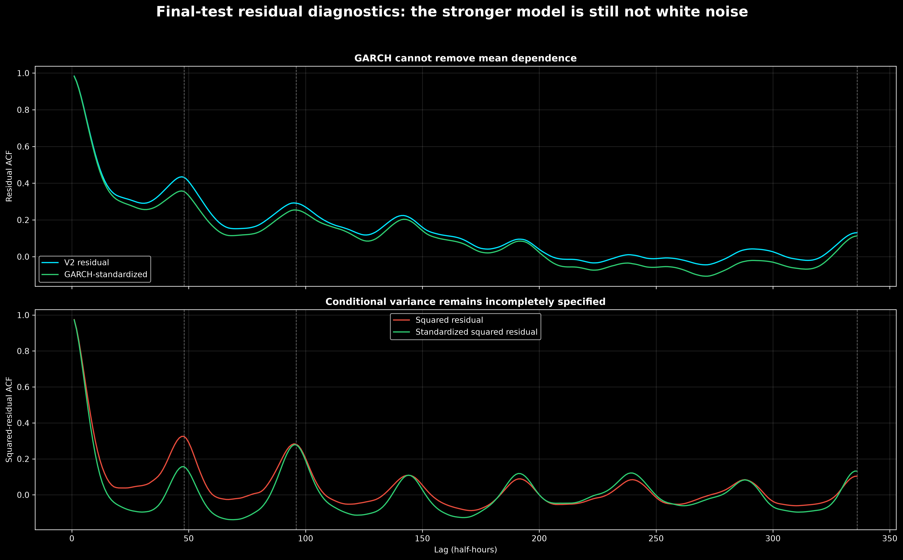

# Event-blind v2 — January–March 2025 final test

## Protocol

The model specification was locked in commit `0c3d4b9` before the final outcomes were
opened. The model was then fitted through 30 December 2024 and evaluated once on all
4,318 settlement intervals from 1 January through 31 March 2025. No feature, lag, alpha,
transformation or variance specification was changed afterward.

## Point-forecast result

| Forecast | MAE | RMSE | Mean error, actual − forecast |
|---|---:|---:|---:|
| Weekly seasonal naive | 3,101 MW | 3,955 MW | −101 MW |
| V1 calendar + weekly lag | 2,401 MW | 3,007 MW | +881 MW |
| **Locked v2** | **1,622 MW** | **2,141 MW** | **+202 MW** |
| NESO day-ahead | **781 MW** | **1,051 MW** | −114 MW |

V2 reduces MAE by 32.4% relative to v1 and 47.7% relative to weekly naive. The improvement
generalizes to a genuinely untouched season and is present in January, February and
March. NESO remains approximately twice as accurate, so the research model still lacks
important ex-ante information.



## Stability by month

| Month | V1 MAE | V2 MAE | NESO MAE | V2 mean error |
|---|---:|---:|---:|---:|
| January | 2,640 MW | 1,741 MW | 733 MW | +932 MW |
| February | 2,356 MW | 1,437 MW | 757 MW | +274 MW |
| March | 2,201 MW | 1,671 MW | 850 MW | −595 MW |

The mean error changes sign from under-forecasting in January to over-forecasting in
March. This is remaining seasonal/regime instability, not a constant global bias that
can be removed safely with one intercept.

The worst day is 2 January, with v2 daily MAE of 6,505 MW and uniform under-forecasting.
The model has a bank-holiday indicator for New Year's Day but no separate post-holiday
or weather-forecast information for 2 January. This observation suggests candidate
future features; it is not used to retune the reported test.



## Residual result

The stronger point forecast does not achieve independent errors:

| Lag | V2 residual ACF |
|---:|---:|
| 1 half-hour | 0.983 |
| 2 half-hours | 0.955 |
| 1 day (48) | 0.432 |
| 2 days (96) | 0.291 |
| 1 week (336) | 0.130 |

Ljung–Box rejects zero autocorrelation through lags 48, 96 and 336. This is expected to
some degree in a fixed day-ahead forecast: successive target half-hours experience the
same weather and system shocks, while the model cannot observe tomorrow's earlier errors
at issuance.

It would be easy to lower lag-1 ACF by using the previous actual target residual, but that
would turn the exercise into a 30-minute-ahead forecast and violate the day-ahead task.

## Conditional variance result

The final GARCH fit converges with `α + β = 0.973`, indicating persistent volatility.
Its interval coverage is weaker than development:

| Interval | Nominal | Final observed |
|---|---:|---:|
| Central interval | 80% | 75.7% |
| Central interval | 95% | 90.1% |

ARCH-LM still rejects after standardization, and short-lag squared-residual ACF remains
high. GARCH captures part of the changing scale but not within-day clusters generated by
unobserved common shocks. The Gaussian intervals are too narrow in the new season.



## What was achieved

- A materially more accurate and less biased event-blind point forecast.
- Improvement across four development seasons and one untouched three-month test.
- Correct use of multiple safe lags, Fourier seasonality, regularization, ARX dynamics,
  rolling-origin evaluation and GARCH uncertainty.
- An auditable rejection of an unconverged daily SARIMAX rather than forcing it.

## What was not achieved

- Residual independence.
- Constant conditional variance.
- NESO-level operational accuracy.
- Fully calibrated Gaussian GARCH intervals in the new season.

The remaining structure should not be attacked by adding arbitrary AR orders. The large
NESO advantage and common within-day errors point to missing ex-ante covariates—most
importantly archived weather forecasts, plus richer holiday/working-day and operational
information. The next model should add those inputs and use another untouched period;
January–March 2025 must not be reused as a fresh holdout.

## Reproduction

```bash
.venv/bin/python src/evaluate_event_blind_v2_final_test.py
.venv/bin/python src/plot_event_blind_v2_final_test.py
```
