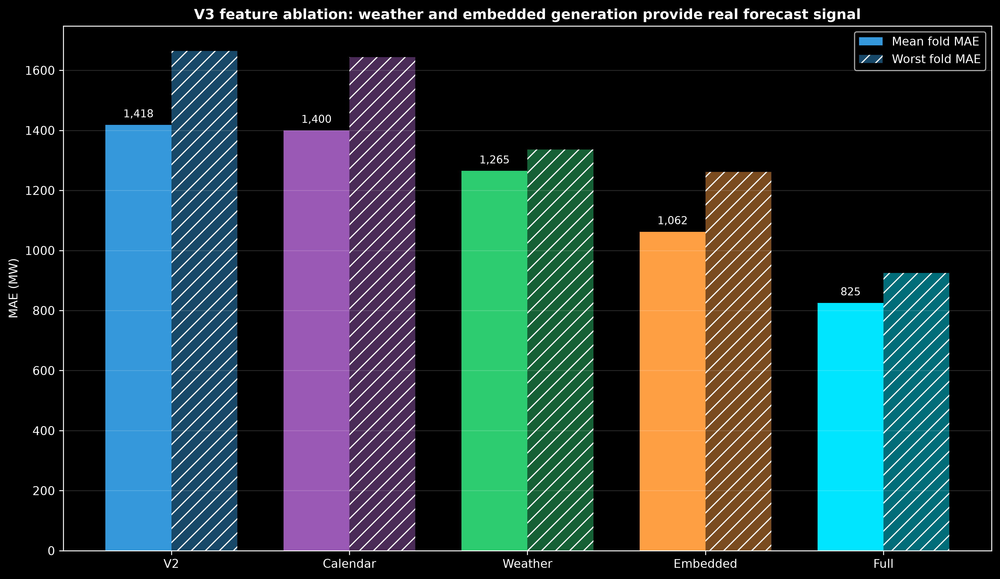
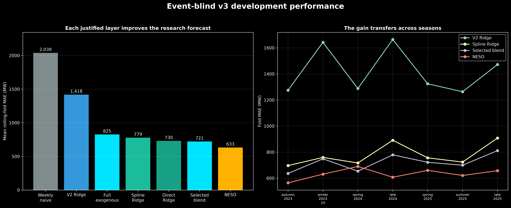
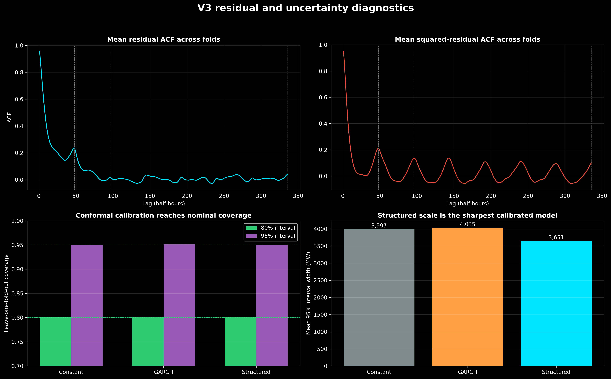

# Event-blind v3 development and model selection

## Feature ablation

Holding the Ridge framework and 730-day training window fixed shows that the improvement
comes from real new information rather than a more complex algorithm.

| Ridge feature set | Mean fold MAE | Worst fold MAE |
|---|---:|---:|
| Reproduced v2 | 1,418 MW | 1,664 MW |
| Rich calendar | 1,400 MW | 1,644 MW |
| Archived weather forecast | 1,265 MW | 1,336 MW |
| Embedded wind/solar forecast | 1,062 MW | 1,262 MW |
| All exogenous inputs | 825 MW | 925 MW |

Calendar information helps modestly, forecast temperature helps substantially, and
embedded generation is the strongest individual addition. Their combined improvement
is larger because they describe different parts of net demand.

## Nonlinearity and dynamics

Fixed temperature hinges at −5, 0, 5, 10, 15, 20 and 25°C reduce MAE to 779 MW. A
standalone boosted residual correction improves the unsplined full Ridge model but does
not beat spline Ridge. The strongest dynamic candidates are:

| Candidate | Mean fold MAE | Worst fold MAE | Mean absolute bias |
|---|---:|---:|---:|
| Spline Ridge | 779 MW | 908 MW | 149 MW |
| Recursive AR(1,2,48,96) errors | 738 MW | 840 MW | 94 MW |
| Direct residual Ridge | 730 MW | 839 MW | 97 MW |
| Direct residual boosting | 734 MW | **806 MW** | **79 MW** |
| **50/50 direct Ridge–boosting blend** | **721 MW** | 812 MW | 85 MW |

The fixed 50/50 blend wins the primary mean-MAE criterion while retaining strong
worst-fold stability. It improves mean-fold MAE by 49.1% relative to reproduced v2 and
64.6% relative to weekly seasonal naive. NESO remains better at 633 MW, about 14% below
the research model.

## ARMA feasibility

Small cutoff-safe ARMA errors do not win:

| Model | Mean fold MAE |
|---|---:|
| ARMA(1,1) | 762 MW |
| ARMA(2,1) | 772 MW |
| ARMA(2,2) | 772 MW |

The result is consistent with the forecast horizon. Moving-average innovations affect
the first few recursive steps, while target intervals begin roughly 28 half-hours after
issuance. Direct horizon-specific correction is more useful.

## Residual diagnostics

The selected model reduces daily dependence but does not create white noise:

| Lag | Development residual ACF |
|---:|---:|
| 1 | 0.956 |
| 2 | 0.897 |
| 48 | 0.257 |
| 96 | 0.041 |
| 336 | 0.072 |

Ljung–Box and ARCH-LM still reject their null hypotheses. Adjacent targets share
unobserved forecast errors, so high short-lag correlation is not removable by adding
tomorrow's unavailable actual residuals.

## Conditional variance and intervals

Uncalibrated Gaussian intervals under-cover: constant variance reaches 87.7% at nominal
95%, GARCH 85.3%, and structured variance 83.8%. Leave-one-fold-out absolute-residual
calibration corrects this without calibrating a fold on itself:

| Scale model | 80% coverage | 95% coverage | Mean 95% width |
|---|---:|---:|---:|
| Constant | 80.05% | 95.01% | 3,997 MW |
| GARCH | 80.14% | 95.11% | 4,035 MW |
| **Structured** | **80.09%** | **95.03%** | **3,651 MW** |

All models satisfy the one-percentage-point coverage constraint. Structured variance is
locked because it is materially sharper. Its full-development critical values are
1.7918 for the central 80% interval and 2.8901 for the central 95% interval.

## Locked pre-test specification

The immutable specification is in `configs/event_blind_v3_model_lock.json`:

- 730-day fixed-spline Ridge mean model;
- direct residual OLS and shallow histogram-gradient boosting;
- fixed 50/50 blend;
- feature-conditioned log-variance scale;
- leave-one-fold-out-derived critical values;
- no NESO demand forecast as an input;
- January–March 2026 unopened.

Residual independence and constant conditional variance are explicitly not claimed.
