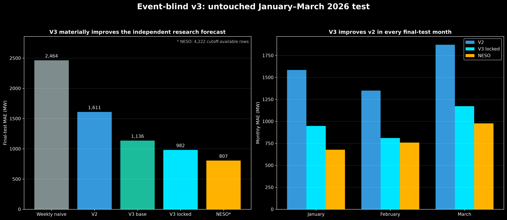
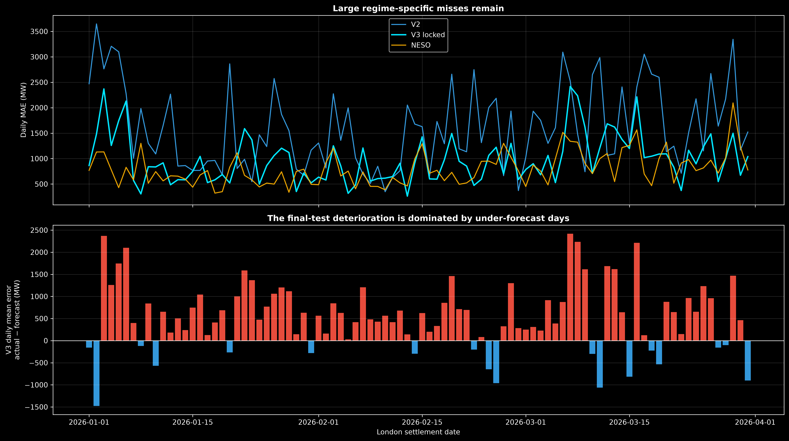
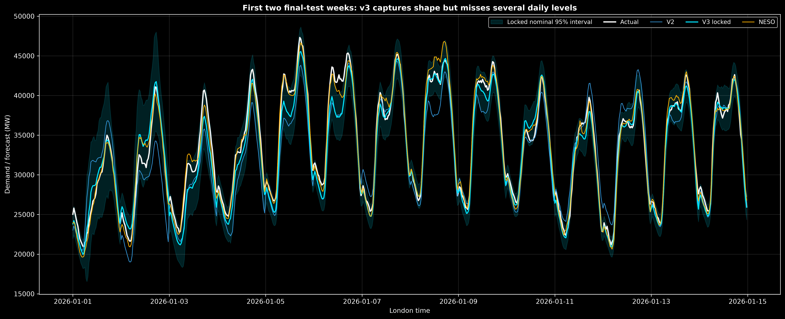
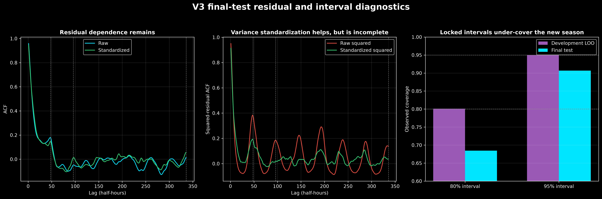

# Event-blind v3 — January–March 2026 final test

## Protocol

The complete v3 specification was locked in commit `adc6f74`, and the lock-driven
evaluator was committed as `ce081da`, before January–March 2026 outcomes were scored.
The model was fitted through 30 December 2025 and evaluated once on all 4,318 protected
settlement intervals. No feature, coefficient rule, hyperparameter, blend weight,
variance model or critical value was changed afterward.

## Point-forecast result

| Forecast | Rows | MAE | RMSE | Mean error, actual − forecast |
|---|---:|---:|---:|---:|
| Weekly seasonal naive | 4,318 | 2,464 MW | 3,334 MW | −131 MW |
| Refit locked-v2 specification | 4,318 | 1,611 MW | 2,139 MW | +161 MW |
| V3 spline base | 4,318 | 1,136 MW | 1,429 MW | +815 MW |
| **Locked v3 blend** | **4,318** | **982 MW** | **1,289 MW** | **+554 MW** |
| NESO, cutoff-available rows | 4,222 | **807 MW** | **1,103 MW** | +65 MW |

V3 reduces MAE by 39.0% relative to the refit v2 specification and 60.1% relative to
weekly seasonal naive. On the 4,222 rows shared with the cutoff-available NESO
benchmark, v3 records 991 MW MAE versus NESO's 807 MW, so NESO remains 22.9% better.

The result generalizes the central v3 claim—weather and embedded-generation forecasts
materially strengthen the independent baseline—but not at the 721 MW development
level. Final MAE is 36% higher than the mean rolling-fold estimate.

## Monthly stability

| Month | V2 MAE | V3 MAE | NESO MAE on available rows | V3 mean error |
|---|---:|---:|---:|---:|
| January | 1,585 MW | **948 MW** | 677 MW | +638 MW |
| February | 1,350 MW | **810 MW** | 758 MW | +405 MW |
| March | 1,873 MW | **1,173 MW** | 976 MW | +606 MW |

V3 improves v2 in every month, but it under-forecasts all three months. The worst days
are 3 January and 7–8 March, where the daily-level error exceeds 2.2 GW. Most of those
days are nearly uniform under-forecasts rather than failures to reproduce the intraday
shape. This suggests a remaining regime/level input, not simply another daily seasonal
lag.

The fixed 50/50 blend remains marginally better than either component: direct Ridge
records 1,009 MW MAE and direct boosting 982.48 MW, versus 982.22 MW for the blend. This
does not justify a post-test weight change.

## Residual dependence

| Lag | V2 residual ACF | V3 residual ACF |
|---:|---:|---:|
| 1 | 0.982 | 0.958 |
| 2 | 0.953 | 0.904 |
| 48 | 0.156 | 0.176 |
| 96 | 0.029 | −0.049 |
| 336 | 0.092 | 0.013 |

V3 reduces very-short and weekly dependence, while the one-day ACF is slightly higher.
Ljung–Box still rejects zero autocorrelation. The errors are not independent: adjacent
half-hours continue to share day-level forecast shocks that cannot be updated after the
day-ahead issuance time.

Squared-residual dependence also falls relative to v2 at the inspected lags, but
ARCH-LM still rejects strongly. Conditional variance is not constant.

## Interval result

| Interval | Development LOO coverage | Final coverage |
|---|---:|---:|
| Central 80% | 80.1% | **68.5%** |
| Central 95% | 95.0% | **90.7%** |

The structured scale changes in the right direction—standardized squared-residual ACF
is smaller—but the locked critical values do not transfer sufficiently. The final
season contains more large errors than the cross-fold calibration anticipated. We do
not recalibrate on the test set, and the reported intervals should not be presented as
well calibrated.

## Conclusion

V3 succeeds as a substantially stronger event-blind point forecast. The largest gains
come from archived embedded wind/solar and temperature forecasts, and the improvement
is present in every final-test month. It does not reach NESO accuracy, eliminate
short-lag error dependence, or deliver stable calibrated intervals in the new season.

Future work should investigate fresher cutoff-specific weather runs and level/regime
information, but January–March 2026 is now opened and cannot be used to select those
changes. A later untouched period is required.
