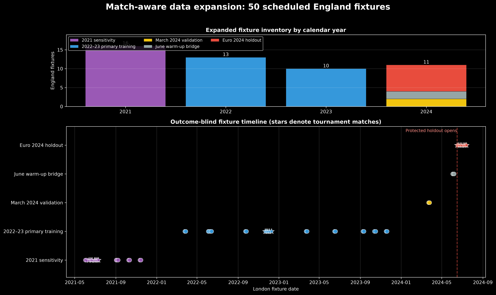

# Match-aware forecasting — Stage 1 data expansion

Status: **complete and tested**

Branch: `match-aware-forecast`
Euro 2024 demand outcomes opened for model selection: **no**

## Purpose

The original development dataset began on 1 January 2023. That window contained only ten England senior men's matches in training and two in validation. It was adequate for the event-blind demand analysis but too small for anything beyond a minimal match correction.

The match-aware branch therefore adds England fixtures and half-hourly demand back to the earliest date supported by the same NESO Day Ahead Half Hourly Demand Forecast Performance source. The expansion is isolated from the finalized core artifacts: it writes to `data/processed/match_aware/` and does not overwrite `demand_halfhour.csv` or `demand_development.csv`.

## Sources and scope

- **Primary target:** NESO `Demand_Outturn`, unchanged from the core project.
- **Extended demand period:** 1 April 2021 through 31 July 2024.
- **Historic demand cross-check:** NESO Historic Demand Data for 2021–2024.
- **Weather:** retrospective ERA5 temperature for London, Manchester and Birmingham. These values remain ineligible for claims of genuine day-ahead forecasting.
- **Fixtures:** official England/FA schedules, UEFA's EURO schedule, and official England World Cup match pages. Every fixture stores a source URL and an explicit British-time to UTC conversion.

The versioned fixture input is `data/england_fixtures_2021_2022.csv`. The reproducible contract is `configs/match_aware_data_contract.json`, and the builder is `src/build_match_aware_data.py`.

## Expansion result

| Item | Result |
|---|---:|
| Complete half-hour UTC grid | 58,464 rows |
| London calendar dates | 1,218 |
| Training rows through February 2024 | 51,122 |
| Validation rows, March–May 2024 | 4,414 |
| Bridge rows, 1–15 June 2024 | 720 |
| Protected Euro holdout rows | 1,440 |
| Post-event context rows | 768 |
| Fixture days with demand coverage | 50 |
| Event-blind baseline-fit rows | 49,152 |
| Missing retrospective weather values | 0 |

## Fixture design

| Role | Fixtures | Intended use |
|---|---:|---|
| 2021 sensitivity events | 16 | Assess sensitivity to pandemic-era demand and viewing behaviour |
| 2022–2023 primary match training | 23 | Learn the pre-specified match correction |
| March 2024 validation events | 2 | Select between already specified correction variants |
| June 2024 warm-up bridge | 2 | Context only; not used for model selection |
| Euro 2024 event holdout | 7 | Final untouched match-aware evaluation |



The 2022–2023 primary sample includes five World Cup 2022 matches. The 2021 sensitivity set includes seven EURO 2020 matches played in 2021, but it is not silently pooled into the primary estimate because pandemic restrictions and home-viewing behaviour may reduce comparability with 2024.

## Schedule-aware features

For each fixture, the dataset calculates how much of every half-hour interval overlaps four windows known from the scheduled kickoff:

| Feature | Scheduled interval relative to kickoff |
|---|---:|
| `pregame_overlap_fraction` | −120 to 0 minutes |
| `scheduled_match_overlap_fraction` | 0 to 105 minutes |
| `halftime_proxy_overlap_fraction` | 45 to 75 minutes |
| `postmatch_overlap_fraction` | 105 to 165 minutes |

Fractions, rather than simple row flags, handle kickoffs at 19:45 correctly. For example, a half-hour interval can overlap only 15 minutes of the planned halftime proxy and receives a value of 0.5. These are scheduled, advance-known features; they do not claim to measure the actual whistle times.

## NESO source-quality finding

The extended source exposed a problem that was outside the original 2023–2024 window:

- **31 October 2021:** conflicting duplicate forecasts occur around the repeated autumn clock hour.
- **30 October 2022:** the source is two half-hours short and also contains duplicated local-clock records.

Neither date contains an England fixture. The pipeline preserves the complete UTC grid but sets the primary forecast-performance fields to missing for both whole dates and marks all 100 intervals `source_quality_eligible = false`. It does not choose a duplicate arbitrarily, substitute Historic ND as though it were the primary target, or interpolate demand. Historic ND remains populated as a cross-check only.

Across eligible rows, `Demand_Outturn` differs from Historic ND by 53.78 MW on average in absolute terms, with a maximum difference of 1,575 MW. This confirms that the two named measures must not be silently interchanged.

## Automated acceptance checks

The repository now has ten passing tests, including four new extended-data tests:

1. The UTC grid is unique and consecutive at 30-minute spacing.
2. The two upstream source failures are explicit and confined to exactly 100 rows.
3. All 50 fixtures have demand coverage and the intended role counts.
4. Baseline-fit rows exclude match days and source-quality failures.
5. Event-window overlap fractions are bounded between zero and one.
6. Each fixture contains exactly the intended total scheduled overlap.
7. The modelling artifact ends on 31 May 2024 and contains no Euro holdout rows.

Reproduce the build and tests with:

```bash
.venv/bin/python src/build_match_aware_data.py --download
.venv/bin/python -m unittest discover -s tests -v
```

## Decision carried forward

The primary match correction will be developed on the 23 fixtures from 2022–2023. The complete 39-fixture 2021–2023 history will be a pre-specified sensitivity. The two March 2024 matches are validation events, and the seven Euro 2024 matches remain unopened until the event-blind baseline, match feature form, and scoring rules are locked.
