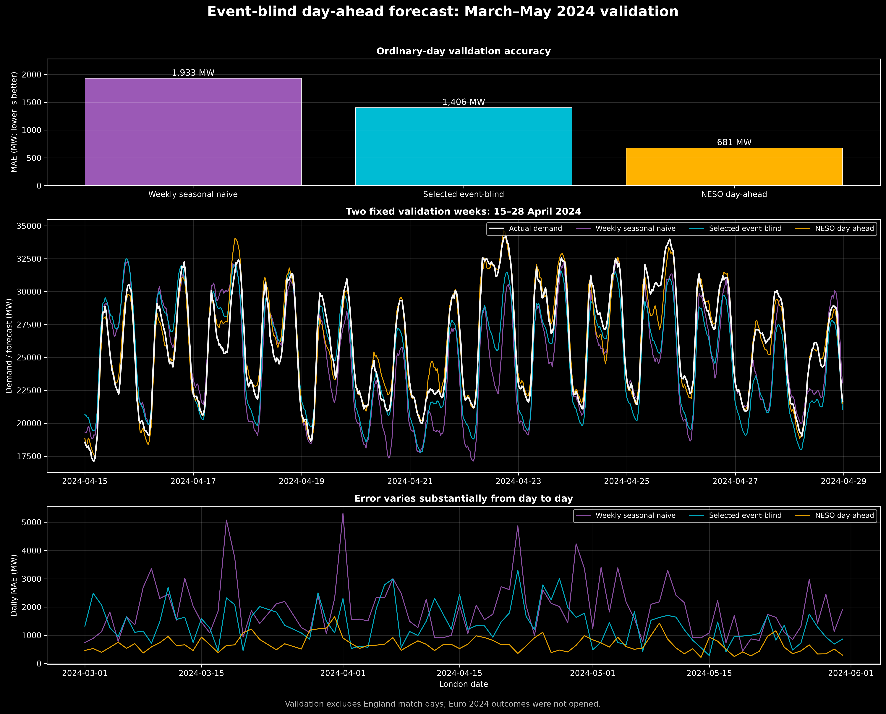
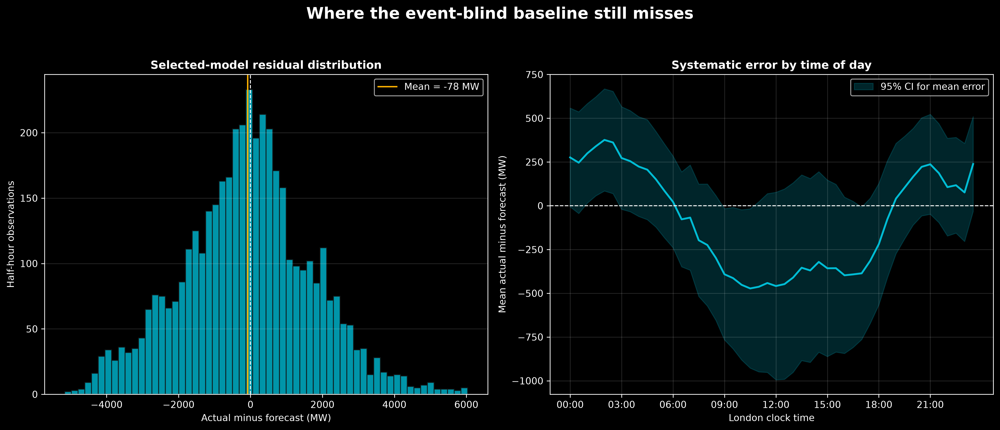

# Stage 2 — Event-blind day-ahead baseline

## Purpose

Before adding football information, the project needs a forecast that knows nothing
about matches. The match-aware model will later be judged by whether scheduled match
features improve this same forecast. Without this control forecast, an apparent
improvement could merely come from learning ordinary daily or weekly demand patterns.

This is a forecasting stage, not a causal estimate of football's effect.

## Information boundary

The forecasting decision is treated as being made at **10:00 London time on the day
before delivery**. Every feature must therefore be known by then.

Allowed inputs in this stage are:

- calendar date and London clock time;
- half-hour-of-week;
- a smooth annual seasonal phase;
- known GB bank holidays;
- demand at the same half-hour seven days earlier (`lag 336`).

The next day's half-hourly demand, lag 1 for tomorrow, and observed future weather are
not allowed. Actual weather was deliberately excluded because the current dataset does
not contain archived day-ahead weather forecasts. Euro 2024 demand outcomes were also
not opened.

## Data separation

| Purpose | Dates / rows | Match handling |
|---|---:|---|
| Candidate fitting | 1 Apr 2021–29 Feb 2024, or 1 Jan 2022–29 Feb 2024 | All England match dates excluded |
| Ordinary validation | 1 Mar–31 May 2024; 4,318 half-hours | Two England match dates excluded |
| Match validation | Two March 2024 matches | Not inspected in this stage |
| Final event holdout | Euro 2024 | Protected and unopened |

This separation prevents the ordinary-demand model from absorbing a match signature
and prevents match outcomes from selecting the baseline.

## Candidate models

Only three candidates were specified before validation was inspected:

1. **Calendar seasonal:** 336 local half-hour-of-week effects, with slot-specific
   annual sine and cosine terms, a linear trend and a bank-holiday indicator.
2. **Calendar + weekly lag, full history:** the same specification plus demand at the
   corresponding UTC half-hour seven days earlier.
3. **Calendar + weekly lag, recent history:** candidate 2 fitted from 1 January 2022
   rather than April 2021. This tests whether older observations are less representative
   of 2024 demand.

The models are sparse linear regressions fitted with LSQR. The weekly-lag timestamp is
checked to be exactly 336 half-hours earlier, so a row shift cannot silently cross a
gap. The local calendar features describe the clock pattern; the lag describes recent
system conditions. These two sources of information complement one another.

The pre-specified selection rule is the lowest mean absolute error (MAE) on ordinary
March–May 2024 validation rows.

## Validation results

| Forecast | Fit start | Train rows | MAE (MW) | RMSE (MW) | Mean error, actual − forecast (MW) |
|---|---:|---:|---:|---:|---:|
| Weekly seasonal naive | — | — | 1,932.9 | 2,526.4 | −634.6 |
| Calendar seasonal | 1 Apr 2021 | 49,152 | 1,536.4 | 1,932.6 | +489.8 |
| Calendar + weekly lag, full | 1 Apr 2021 | 48,716 | 1,444.4 | 1,846.0 | +326.0 |
| **Calendar + weekly lag, recent** | **1 Jan 2022** | **36,718** | **1,406.1** | **1,811.7** | **−78.3** |
| NESO day-ahead | — | — | 681.2 | 914.3 | −57.5 |

The selected model improves MAE by **27.3%** over simply reusing demand from the
previous week. Its near-zero overall mean error is also substantially less biased than
the weekly naive forecast. Starting in 2022 performs better than using all available
history, consistent with older demand levels being less representative of 2024.

NESO's operational forecast is still much stronger: its 681 MW MAE is roughly half the
selected model's 1,406 MW. That benchmark likely benefits from richer operational and
weather information that is outside this reproducible research dataset. The relevant
next question is therefore not whether the small research model beats NESO, but whether
known England fixtures add information beyond the locked event-blind forecast.



## Remaining error structure

The selected residual is `actual demand − forecast`. Positive values mean the model
forecast too little; negative values mean it forecast too much.

- Median absolute error is about 1,102 MW and the 90th percentile is about 3,020 MW.
- The overall mean error is only −78 MW, but errors are not evenly distributed through
  the day.
- Average under-forecasting is largest around 02:00 London time (+376 MW).
- Average over-forecasting is largest around 10:30 (−472 MW).
- Daily MAE varies sharply, showing that the model captures the recurring shape better
  than unusual day-specific conditions.

The confidence band in the time-of-day panel is for the **mean error at each clock
slot**, not a forecast interval for an individual half-hour. Parts of the daytime band
remain below zero, so the time-of-day bias is systematic enough to investigate.



## Decision and limitations

`calendar_plus_weekly_lag_recent` is now the locked event-blind baseline for constructing
historical match residuals. We do not add more ordinary-validation candidates after
seeing these scores, because repeatedly searching the same validation set would turn it
into another training set.

Important limitations are:

- only three ordinary-model forms were compared;
- there is no archived weather-forecast input;
- residuals are likely serially correlated and heteroskedastic;
- the model supplies point forecasts only, not calibrated probabilistic intervals;
- the NESO benchmark shows considerable headroom for richer operational forecasting.

The next stage formally tests residual autocorrelation and changing variance. After
that, match corrections are learned from event-blind residuals on historical match days,
with each match treated as an event cluster rather than 48 independent observations.

## Reproduction

```bash
.venv/bin/python src/fit_event_blind_models.py
.venv/bin/python src/plot_event_blind_validation.py
```

Machine-readable metrics and validation predictions are written beneath
`data/processed/match_aware/modeling/`. The scripts and the high-resolution figures are
versioned; the derived CSV/model artifacts remain reproducible and gitignored.
