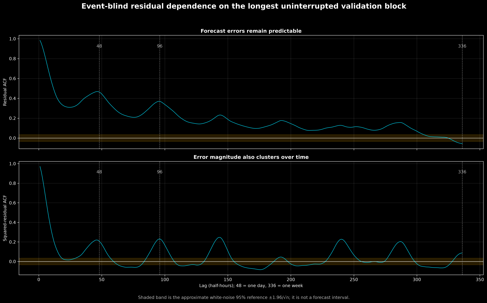

# Stage 3 — Event-blind residual diagnostics

## Why diagnose the errors?

A useful point forecast can still leave structured errors. If adjacent forecast errors
move together, 48 half-hours from one match day are not 48 independent pieces of
evidence. If error variance changes over time, a single constant standard error is also
misleading. Both issues matter when the project has only a few dozen historical matches.

These diagnostics use only ordinary validation demand. The two March 2024 England match
days and the Euro 2024 holdout remain unopened.

## Scope and gap handling

Removing match days creates gaps in the validation time series. Simply concatenating
the remaining rows would make the half-hour before an excluded day appear adjacent to
the half-hour after it. To avoid that false relationship, the formal time-series tests
use the longest uninterrupted ordinary-validation block:

- **start:** 27 March 2024 00:00 UTC;
- **end:** 31 May 2024 22:30 UTC;
- **observations:** 3,166 consecutive half-hours.

## Autocorrelation results

The autocorrelation function (ACF) measures how strongly an error is associated with an
earlier error. An ACF near +1 at lag 1 means that if the model under-forecasts one
half-hour, it is very likely to under-forecast the next half-hour too.

| Lag | Interpretation | Residual ACF | Squared-residual ACF |
|---:|---|---:|---:|
| 1 | 30 minutes | 0.983 | 0.971 |
| 2 | 1 hour | 0.954 | 0.918 |
| 48 | 1 day | 0.464 | 0.207 |
| 96 | 2 days | 0.370 | 0.231 |
| 336 | 1 week | −0.056 | 0.087 |

The forecast error is extremely persistent over neighbouring half-hours. A clear daily
cycle remains at lags 48 and 96. The residual weekly correlation is small, which is
consistent with the selected baseline already using the previous week's demand.

The squared-residual ACF asks a different question: do large errors tend to be followed
by other large errors, regardless of sign? Its high short-lag values and repeated daily
peaks show error-magnitude clustering.



The gold band is the approximate white-noise reference, `±1.96 / sqrt(n)`. It is only a
visual reference. Because autocorrelations at nearby lags are related and hundreds of
lags are displayed, the graph should not be read as hundreds of separate discoveries.

## Formal tests

The Ljung–Box test has a null hypothesis that the residual autocorrelations through the
chosen lag are jointly zero.

| Maximum lag | Ljung–Box statistic | p-value |
|---:|---:|---:|
| 1 | 3,063.5 | below numerical display precision |
| 2 | 5,950.4 | below numerical display precision |
| 48 | 39,082.9 | below numerical display precision |
| 96 | 53,156.4 | below numerical display precision |
| 336 | 69,235.7 | below numerical display precision |

The null of white-noise residuals is decisively rejected. This does not mean the point
forecast is useless; it means the baseline has not extracted all predictable temporal
structure and ordinary independent-error formulas are inappropriate.

The 48-lag ARCH-LM test checks whether squared errors depend on earlier squared errors.
Its statistic is 2,981.7 and its p-value is also below numerical display precision, so
constant conditional variance is rejected.

## Consequences for the match-aware stage

These results change how the next stage is evaluated:

1. **The match is the unit of validation.** Leave-one-match-out validation will hold out
   an entire fixture. Half-hours from the same match cannot be split across train and
   validation folds.
2. **No future error correction is allowed.** A day-ahead forecast cannot use residuals
   observed during tomorrow's match, even though lag-1 residuals are highly predictive.
3. **Report event-level variation.** We will show per-match changes as well as pooled
   half-hour metrics so one long sequence cannot masquerade as a large sample.
4. **Keep the correction small.** With only 23 primary historical training fixtures,
   a few schedule-overlap coefficients are more defensible than a large dynamic model.
5. **Treat intervals cautiously.** Any uncertainty interval should use match-level
   resampling or cluster-aware logic, not an independent half-hour standard error.

The residual pattern also explains part of the gap to NESO: an operational forecast can
update for weather, system conditions and other day-specific information that the small
calendar model does not contain. The match-aware correction is not expected to repair
all of that structure; it is designed to test whether a known fixture schedule adds a
repeatable increment.

## Reproduction

```bash
.venv/bin/python src/diagnose_event_blind_residuals.py
```

The exact statistics are written to
`data/processed/match_aware/modeling/event_blind_residual_diagnostics.json`.
