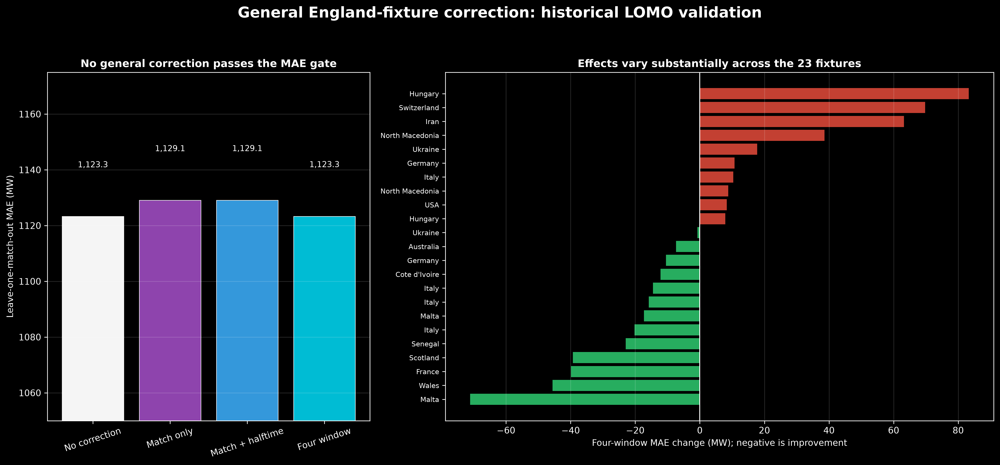
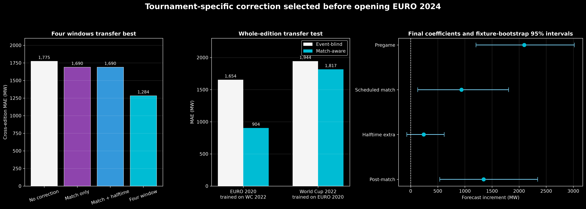

# Stage 4 — Match-correction selection

## Question

Can information known from the England fixture schedule improve the locked event-blind
day-ahead forecast?

This is a predictive question. A positive coefficient does **not** prove that football
caused demand to increase. Schedule terms can absorb repeatable forecast errors associated
with match timing, tournament season, audience behaviour, weather omitted from the model,
or other correlated conditions.

## Candidate schedule representations

Three deliberately small correction forms were fixed before their match-validation
results were inspected:

1. **Scheduled match only** — one correction across the scheduled 105-minute match.
2. **Match plus halftime** — the match correction plus a distinct 30-minute halftime
   proxy centred on scheduled minute 45–75.
3. **Four window** — separate pregame, scheduled-match, halftime-extra and post-match
   corrections.

The overlap features are fractional. For example, if only 15 minutes of a half-hour
lies in the halftime proxy, its halftime fraction is 0.5. This correctly handles 19:45
kickoffs without forcing event boundaries onto the settlement grid.

All validation splits hold out complete fixtures. Half-hours from one fixture never
appear in both fitting and evaluation data.

## Experiment A: one correction for every England fixture

The first experiment used the 23 primary 2022–2023 historical fixtures. For fitting,
each training fixture received its own nuisance intercept and linear slope over a wider
context window. These nuisance terms remove broad day-specific offset and drift so the
global schedule coefficients describe a recurring within-fixture shape. They are not
applied to a held-out or future fixture.

Selection used leave-one-match-out (LOMO) validation. The primary score covers the union
of the pregame, scheduled-match and post-match windows: 230 half-hours across 23 held-out
fixtures.

| LOMO forecast | MAE (MW) | RMSE (MW) | Change in MAE vs event-blind |
|---|---:|---:|---:|
| **Event-blind / no correction** | **1,123.28** | 1,525.48 | — |
| Scheduled match only | 1,129.06 | 1,530.09 | 5.79 MW worse |
| Match plus halftime | 1,129.10 | 1,530.20 | 5.82 MW worse |
| Four window | 1,123.33 | 1,519.74 | 0.06 MW worse |

The four-window model improved 13 of 23 individual fixture MAEs and slightly improved
RMSE, but its pooled MAE was essentially tied and marginally worse. The pre-declared
deployment gate requires an actual MAE improvement, so the selected general-fixture
policy is **no correction**.



The heterogeneous per-match bars explain why a single correction struggles: a shape
that helps one fixture can hurt another. The general four-window halftime-extra estimate
was only +67 MW, with a fixture-bootstrap 95% interval from −26 to +172 MW. The data do
not support a stable general halftime correction across friendlies, qualifiers, Nations
League and tournament matches combined.

## Why test tournaments separately?

The intended final deployment is EURO 2024, but most of the 23 primary fixtures are not
major tournament matches. Tournament matches can have much larger audiences and are a
more relevant reference class. The expanded dataset supplies:

- seven England matches from UEFA EURO 2020, played in 2021;
- five England matches from FIFA World Cup 2022.

This creates 12 historical tournament fixtures rather than trying to learn a EURO model
from only the 2022–2023 mixed fixture set.

For this predictive experiment, the coefficients estimate the average residual in each
scheduled window directly; fixture nuisance offsets are not removed. This allows a known
tournament schedule to correct a recurring level error as well as its within-event
shape. Because this can also absorb omitted seasonal conditions, it must not be given a
causal interpretation.

## Experiment B: transfer to an unseen tournament edition

The validation unit is now an entire tournament edition:

- fit on World Cup 2022 and predict all seven EURO 2020 matches;
- fit on EURO 2020 and predict all five World Cup 2022 matches.

This is closer to the real task—predicting a new tournament—than mixing matches from the
same edition across folds.

| Cross-edition forecast | MAE (MW) | RMSE (MW) | MAE improvement |
|---|---:|---:|---:|
| Event-blind / no correction | 1,774.96 | 2,212.97 | — |
| Scheduled match only | 1,689.78 | 2,121.70 | 85.18 MW |
| Match plus halftime | 1,689.71 | 2,121.99 | 85.25 MW |
| **Four window** | **1,284.35** | **1,605.07** | **490.61 MW (27.6%)** |

The four-window correction transfers in both directions:

| Held-out edition | Event-blind MAE | Four-window MAE | Change |
|---|---:|---:|---:|
| EURO 2020, trained on World Cup 2022 | 1,654 MW | 904 MW | 750 MW better |
| World Cup 2022, trained on EURO 2020 | 1,944 MW | 1,817 MW | 127 MW better |



Fitting the selected form to all 12 historical tournament fixtures gives these forecast
increments:

| Window term | Increment (MW) | Fixture-bootstrap 95% interval (MW) |
|---|---:|---:|
| Pregame | +2,094 | +1,205 to +3,019 |
| Scheduled match | +937 | +129 to +1,806 |
| Halftime extra | +241 | −71 to +618 |
| Post-match | +1,345 | +535 to +2,343 |

During the halftime proxy, both the scheduled-match term and the halftime-extra term are
active. At full overlap, the total correction is therefore about **+1,178 MW**, not
+241 MW. However, the distinct halftime increment crosses zero in the fixture-cluster
bootstrap interval. The evidence supports a broad tournament-window forecast correction
more clearly than a precisely estimated additional halftime spike.

## Stability warning

There are only two historical tournament editions. A within-edition LOMO sensitivity is
strong for EURO 2020 (MAE 1,654 to 945 MW) but weak for the five World Cup matches (MAE
1,944 to 2,218 MW). One reason is that individual World Cup fixtures have very different
baseline errors, and five events cannot stabilize four coefficients.

Therefore the selected four-window tournament correction is promising but high-risk.
It passed the pre-holdout cross-edition gate and is now locked for EURO 2024 evaluation;
it is not presented as a universally reliable football-demand model.

At this point:

- general future England fixture: use the event-blind forecast unchanged;
- known major tournament fixture: use the locked four-window tournament correction;
- March 2024 friendlies and EURO 2024 demand outcomes remain unopened;
- no coefficient or window will be changed after the EURO 2024 results are inspected.

## Reproduction

```bash
.venv/bin/python src/select_match_correction.py
.venv/bin/python src/select_tournament_correction.py
.venv/bin/python src/plot_match_correction_selection.py
```

Machine-readable selection results and cross-validated predictions are written beneath
`data/processed/match_aware/modeling/`.
