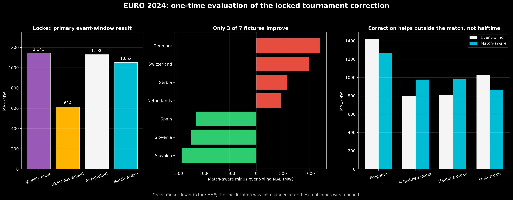
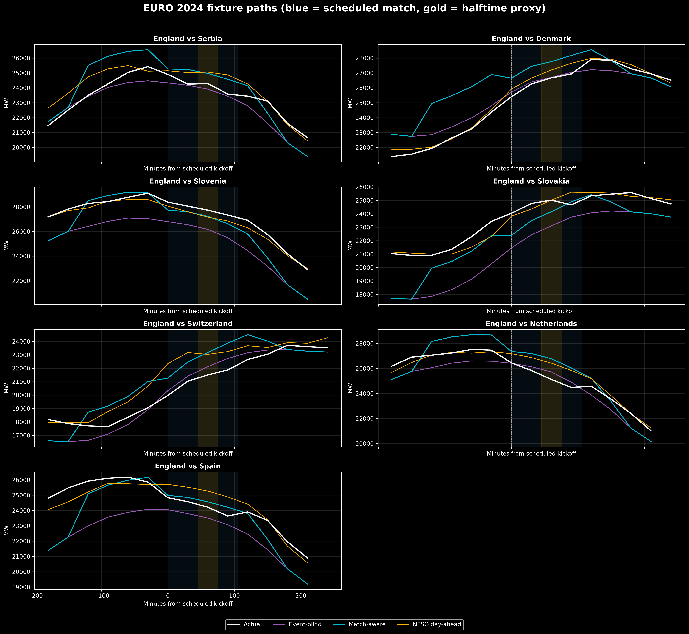

# Stage 5 — EURO 2024 holdout evaluation

## One-time evaluation protocol

The EURO 2024 demand outcomes were opened only after the following choices were committed:

- event-blind model: recent-history calendar regression plus weekly lag;
- tournament correction: four scheduled overlap windows;
- coefficients: fitted on 12 matches from EURO 2020 and World Cup 2022;
- primary score: MAE over the union of pregame, scheduled-match and post-match windows;
- evaluation unit for uncertainty: the complete fixture.

No window, coefficient, feature or selection rule was changed after this evaluation.
The holdout contains all seven England matches at EURO 2024 and 70 half-hours in the
primary correction window.

## Primary result

| Forecast | MAE (MW) | RMSE (MW) | Mean error: actual − forecast (MW) |
|---|---:|---:|---:|
| Weekly seasonal naive | 1,143 | 1,583 | −470 |
| NESO day-ahead | **614** | **799** | −349 |
| Locked event-blind | 1,130 | 1,426 | +909 |
| Locked match-aware | 1,052 | 1,254 | −550 |

Relative to the project event-blind model, the schedule correction reduced primary MAE
by **77 MW (6.8%)** and RMSE by **172 MW (12.1%)**. It also reversed the baseline's
under-forecast bias into an over-forecast bias. This is a modest aggregate improvement,
not a uniformly successful model.

Only three of seven fixture MAEs improved. A fixture-cluster bootstrap gives a 95%
interval from **−863 to +674 MW** for `match-aware MAE − event-blind MAE`. Negative is
better, and the observed average is −77 MW, but the interval crosses zero widely. Seven
fixtures are not enough to establish that the average improvement is stable.



## Result by fixture

| Opponent | Event-blind MAE | Match-aware MAE | Change (negative is better) |
|---|---:|---:|---:|
| Serbia | 525 MW | 1,098 MW | +573 MW |
| Denmark | 479 MW | 1,666 MW | +1,187 MW |
| Slovenia | 1,876 MW | 649 MW | −1,227 MW |
| Slovakia | 2,266 MW | 869 MW | −1,397 MW |
| Switzerland | 535 MW | 1,527 MW | +992 MW |
| Netherlands | 651 MW | 1,107 MW | +456 MW |
| Spain | 1,574 MW | 450 MW | −1,124 MW |

The correction helps most when the event-blind forecast is already far below actual
demand, as for Slovenia, Slovakia and Spain. It damages several fixtures where the
event-blind forecast was already close. A constant tournament correction cannot know in
advance which of those situations will occur.



The panels show why event-level reporting matters: a pooled score hides large and
opposite fixture outcomes. The gold band is the scheduled halftime proxy, not the exact
whistle-to-whistle halftime observed from match logs.

## Did halftime awareness help?

No. The holdout does not support that conclusion.

| Evaluation window | Event-blind MAE | Match-aware MAE | Change |
|---|---:|---:|---:|
| Pregame | 1,424 MW | 1,265 MW | 158 MW better |
| Scheduled match | 799 MW | 976 MW | 177 MW worse |
| Halftime proxy | 808 MW | 984 MW | 176 MW worse |
| Post-match | 1,032 MW | 866 MW | 166 MW better |

The selected model activates the scheduled-match coefficient throughout the match and
adds the halftime coefficient during the proxy. Historical fitting therefore added
about 1,178 MW at full halftime overlap. On EURO 2024, the event-blind mean error during
the halftime proxy was only +516 MW. The correction overshot, producing a −542 MW mean
error and worse MAE.

This confirms the warning from Stage 4: the distinct halftime increment was uncertain,
and the historical cross-edition improvement described a broad tournament window more
than a stable halftime spike. The aggregate primary improvement is driven by pregame and
post-match rows, not halftime.

## Broader forecast comparison

Across the complete 30-day holdout period:

| Forecast | MAE (MW) | RMSE (MW) |
|---|---:|---:|
| Weekly seasonal naive | 1,217 | 1,635 |
| NESO day-ahead | **531** | **685** |
| Event-blind | 1,434 | 1,735 |
| Match-aware | 1,430 | 1,728 |

The match correction is zero outside scheduled windows, so it cannot fix the event-blind
model's broader summer calibration drift. The simple weekly naive forecast beats the
research event-blind model over this period, while NESO is substantially better than all
project models. This reinforces that the operational forecast contains important
day-specific information absent from our calendar-plus-lag model.

## Final interpretation

The result supports three restrained conclusions:

1. Historical tournament schedules contain some transferable predictive information:
   the locked correction improved the aggregate EURO 2024 event-window score.
2. That improvement is unstable across fixtures and is not statistically resolved with
   seven match clusters.
3. The correction did **not** improve the scheduled match or halftime proxy. This project
   therefore cannot claim a robust halftime-aware forecast, and it still makes no causal
   claim about football's effect on demand.

A stronger next version would need more tournament editions, archived weather forecasts,
audience/importance information known before kickoff, and actual halftime timestamps.
Those additions should be evaluated on a new untouched tournament, not used to retune
this EURO 2024 result.

## Reproduction

```bash
.venv/bin/python src/evaluate_euro_2024_holdout.py
.venv/bin/python src/plot_euro_2024_holdout.py
```

Exact metrics and predictions are written beneath
`data/processed/match_aware/modeling/`. The selection artifacts remain unchanged and
continue to record that the holdout was unopened at the moment the model was locked.
