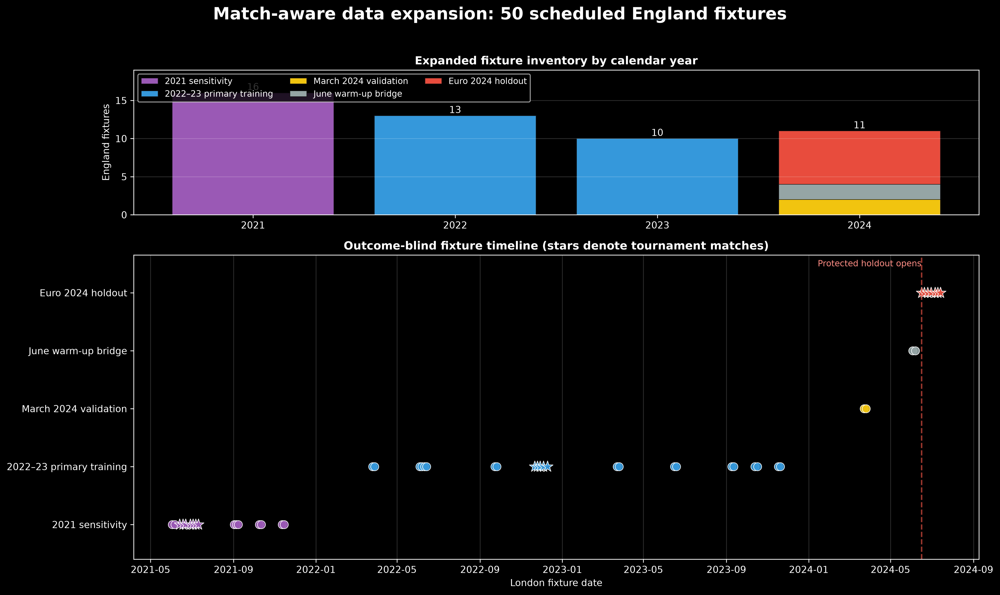
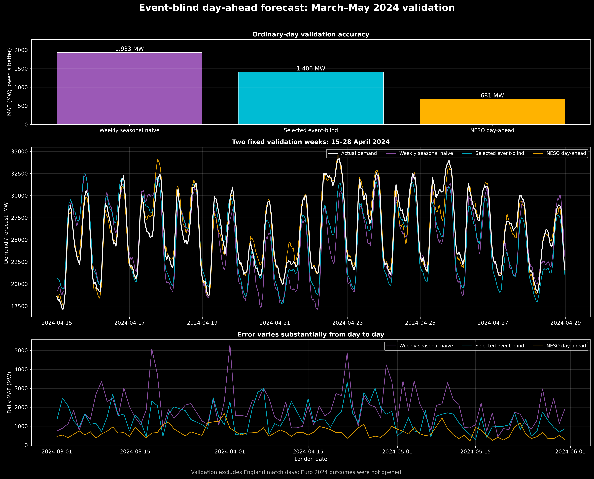
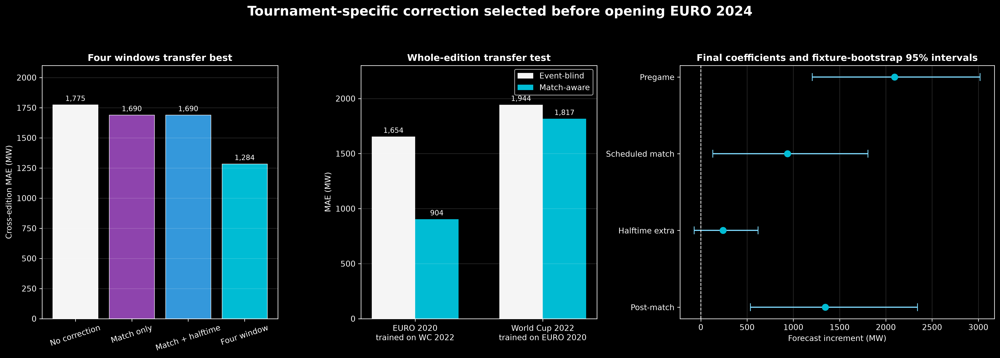
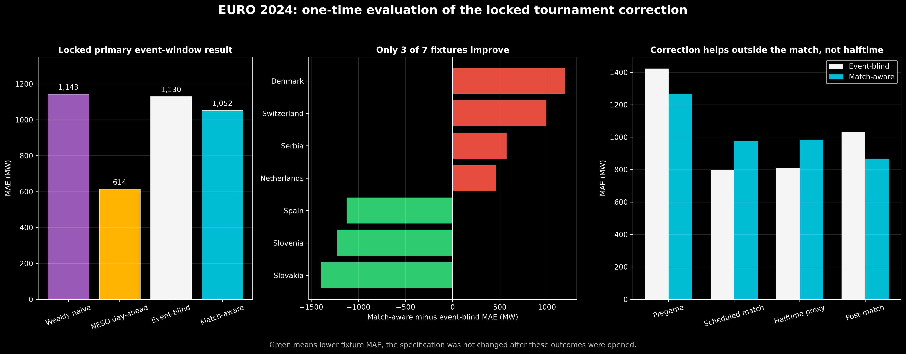

# Match-aware demand forecasting — final report index

Branch: `match-aware-forecast`

Core project artifacts overwritten: **no**

EURO 2024 holdout opened: **yes, once, after specification lock**

Model changed after holdout: **no**

## Project question

If a future England match date and scheduled kickoff are known, can those schedule
details improve a day-ahead half-hourly Great Britain electricity-demand forecast?

The project addresses prediction, not causality. It does not estimate how much demand
football alone caused. The schedule correction may contain correlated tournament,
seasonal, audience or omitted-weather information.

## Final answer

There is some tournament-window predictive signal, but the evidence is too unstable to
call the model robust and it does not improve halftime forecasting.

- The event-blind baseline reduced ordinary-validation MAE from 1,933 MW for a weekly
  seasonal naive forecast to 1,406 MW. NESO's operational forecast was much stronger at
  681 MW.
- A single correction across 23 mixed England fixtures did not improve leave-one-match-
  out MAE. The deployment policy for an ordinary future fixture is therefore no match
  correction.
- A four-window tournament correction trained on EURO 2020 and World Cup 2022 reduced
  leave-one-edition-out MAE from 1,775 to 1,284 MW (27.6%).
- On the untouched EURO 2024 primary event window, that locked correction reduced MAE
  from 1,130 to 1,052 MW (6.8%) and RMSE from 1,426 to 1,254 MW (12.1%).
- Only 3 of 7 EURO 2024 fixtures improved. The fixture-bootstrap interval for average
  MAE change crossed zero widely.
- Halftime-proxy MAE worsened from 808 to 984 MW. The aggregate gain came from pregame
  and post-match periods, so this is not a successful halftime-specific forecast.
- NESO remained the best holdout forecast by a large margin: 614 MW MAE in the primary
  window.

## Research trail

Each document records the decisions available at that stage rather than rewriting the
history after seeing the final result.

1. [Data expansion and audit](01_data_expansion.md)
   - 58,464-row UTC grid from April 2021 through July 2024;
   - 50 verified England fixtures and explicit event roles;
   - source defects isolated on two non-match DST dates;
   - schedule-overlap features that handle :45 kickoffs.
2. [Event-blind baseline](02_event_blind_baseline.md)
   - information boundary fixed at 10:00 London time on the previous day;
   - three pre-specified candidates;
   - locked calendar-plus-weekly-lag model selected on ordinary days only.
3. [Residual diagnostics](03_residual_diagnostics.md)
   - strong half-hour and daily residual autocorrelation;
   - changing error variance;
   - whole-fixture validation required.
4. [Match-correction selection](04_match_correction_selection.md)
   - general correction rejected;
   - tournament-specific four-window correction selected by cross-edition transfer;
   - coefficients and match-cluster bootstrap intervals locked before EURO 2024.
5. [EURO 2024 holdout](05_euro_2024_holdout.md)
   - one-time evaluation on seven fixtures;
   - aggregate gain but strong fixture heterogeneity;
   - scheduled-match and halftime result fails.

## Model architecture

The final research forecast has two layers:

```text
calendar + annual seasonality + bank holiday + demand one week earlier
                              │
                              ▼
                    event-blind forecast
                              │
           known major tournament fixture?
                    ┌─────────┴─────────┐
                   no                  yes
                    │                   │
             no correction      add fractional overlap terms
                                for pregame / match /
                                halftime extra / post-match
```

The correction is known before delivery because it uses only scheduled kickoff and
competition metadata. Actual whistle times, actual weather and tomorrow's demand are not
features.

## Important figures









## Repository map

| Path | Purpose |
|---|---|
| `configs/match_aware_data_contract.json` | Dates, source resources, split and window contract |
| `data/england_fixtures_2021_2022.csv` | Versioned historical fixture input |
| `src/build_match_aware_data.py` | Isolated extended-data builder |
| `src/fit_event_blind_models.py` | Ordinary-day candidate fitting and selection |
| `src/diagnose_event_blind_residuals.py` | ACF, Ljung–Box and ARCH-LM diagnostics |
| `src/select_match_correction.py` | General 23-fixture LOMO experiment |
| `src/select_tournament_correction.py` | Two-edition tournament transfer experiment |
| `src/evaluate_euro_2024_holdout.py` | Frozen one-time holdout evaluation |
| `src/plot_*.py` | Reproducible 300-dpi figures |
| `tests/test_match_aware_data.py` | Extended data-contract checks |
| `tests/test_match_aware_models.py` | Selection/holdout leakage and freeze checks |

Derived model CSV/JSON artifacts are written to
`data/processed/match_aware/modeling/` and remain gitignored. Versioned inputs, code,
tests, documents and figures are committed.

## Reproduction order

From the repository root with the existing virtual environment:

```bash
.venv/bin/python src/build_match_aware_data.py --download
.venv/bin/python src/plot_match_aware_data_audit.py

.venv/bin/python src/fit_event_blind_models.py
.venv/bin/python src/plot_event_blind_validation.py
.venv/bin/python src/diagnose_event_blind_residuals.py

.venv/bin/python src/select_match_correction.py
.venv/bin/python src/select_tournament_correction.py
.venv/bin/python src/plot_match_correction_selection.py

.venv/bin/python src/evaluate_euro_2024_holdout.py
.venv/bin/python src/plot_euro_2024_holdout.py

.venv/bin/python -m unittest discover -s tests -v
```

The holdout has already been evaluated. Re-running the evaluation reproduces the frozen
result; it must not be used to choose new coefficients. Any improved model should define
a new untouched future tournament before development begins.

## What to keep in mind

- `Demand_Outturn` is the primary target. Historic ND is a cross-check, not a silent
  substitute.
- UTC defines the unique half-hour timeline; London time defines calendar features.
- The two excluded DST-source dates are upstream defects, not missing values to fill.
- Retrospective ERA5 weather exists in the extended artifact but is not eligible as a
  genuine day-ahead feature.
- Half-hours within a fixture are highly dependent. Seven games are seven event clusters,
  not 70 independent experiments.
- The halftime window is scheduled minute 45–75. It is a proxy and cannot capture actual
  stoppage time or delayed restarts precisely.
- The final holdout is informative precisely because its weak points were preserved:
  do not retune against EURO 2024 and report it again as if it were new evidence.
