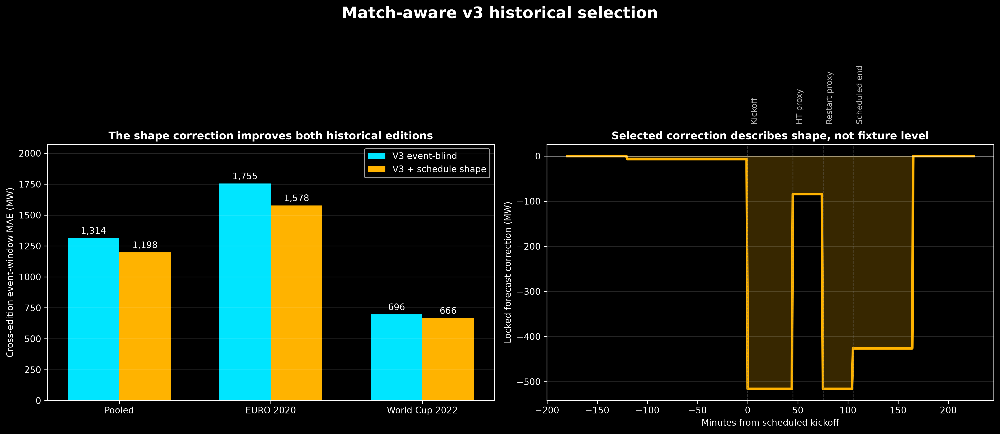
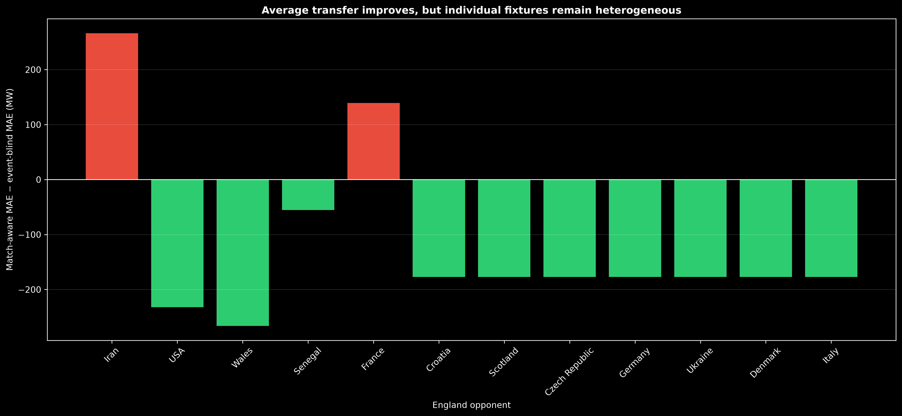

# Stage 1 — Historical schedule-correction selection

## Why a raw level correction failed

Across the 120 scored historical half-hours, v3 records 1,314 MW MAE. Its edition-level
errors differ sharply:

| Held-out edition | V3 MAE | V3 mean error, actual − forecast |
|---|---:|---:|
| UEFA EURO 2020 | 1,755 MW | −1,755 MW |
| FIFA World Cup 2022 | 696 MW | −64 MW |

V3 broadly over-forecasts the early EURO edition but is nearly unbiased during the
World Cup. Raw event-window corrections therefore fail to transfer: the correction
learned from one edition is inappropriate for the other.

## Shape-only correction

The selected model estimates global schedule-window coefficients while giving every
training fixture its own nuisance intercept and linear drift over minutes −240 to 285.
Those nuisance terms absorb broad fixture-level offset and drift during estimation;
they are **not** available or applied to a future fixture. Only the four global schedule
coefficients become the forecast correction.

| Cross-edition forecast | MAE | RMSE | Change in MAE |
|---|---:|---:|---:|
| Locked v3 event-blind | 1,314 MW | 1,626 MW | — |
| **V3 + selected schedule shape** | **1,198 MW** | **1,499 MW** | **116 MW better (8.8%)** |

The gate is satisfied in both directions:

| Held-out edition | Event-blind MAE | Match-aware MAE | Improvement |
|---|---:|---:|---:|
| UEFA EURO 2020 | 1,755 MW | 1,578 MW | 177 MW |
| FIFA World Cup 2022 | 696 MW | 666 MW | 30 MW |

## Locked correction

| Scheduled term | Forecast increment | Fixture-bootstrap 95% interval |
|---|---:|---:|
| Pregame | −7 MW | −187 to +193 MW |
| Scheduled play | −516 MW | −927 to −100 MW |
| Halftime extra | +432 MW | +242 to +637 MW |
| Post-match | −426 MW | −697 to −161 MW |

At full halftime overlap, the scheduled-play and halftime-extra terms are both active,
giving a net correction of approximately **−84 MW**. Thus the model does not predict a
large absolute halftime surge. It predicts partial recovery from the negative
scheduled-play correction.

The fixture bootstrap describes uncertainty conditional on these 12 matches. It cannot
capture uncertainty from having only two tournament editions.

## Locked policy

- Known major England tournament fixture: apply the four-window shape correction to
  the contemporaneously refitted v3 forecast.
- Ordinary or non-tournament fixture: use v3 unchanged.
- Do not tune this correction using the EURO 2024 rerun.
- Treat a future untouched tournament as the required confirmation set.
