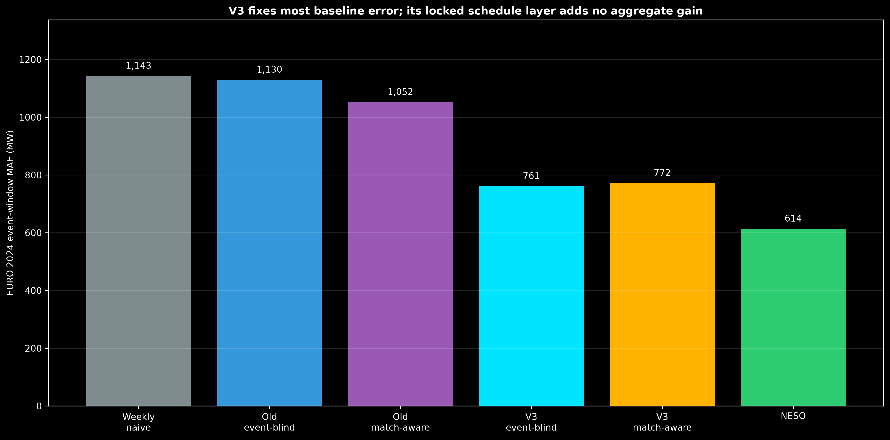
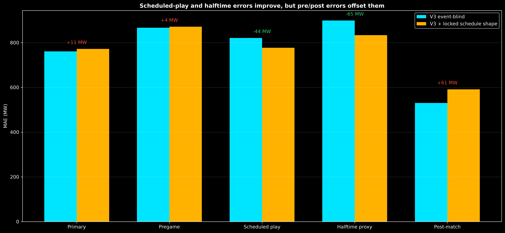
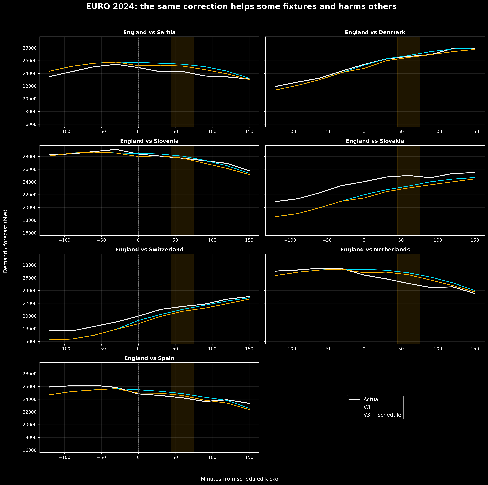

# Stage 2 — EURO 2024 retrospective diagnostic

## Status

This is **not a new holdout**. EURO 2024 outcomes were already examined by the earlier
match-aware project. The selected v3 schedule correction was nevertheless committed as
`37471f6` before this exact rerun, and no coefficient was changed afterward.

## Primary event-window result

| Forecast | MAE | RMSE | Mean error, actual − forecast |
|---|---:|---:|---:|
| Weekly seasonal naive | 1,143 MW | 1,583 MW | −470 MW |
| Earlier event-blind model | 1,130 MW | 1,426 MW | +909 MW |
| Earlier match-aware model | 1,052 MW | 1,254 MW | −550 MW |
| **V3 event-blind** | **761 MW** | **990 MW** | +208 MW |
| V3 + locked schedule shape | 772 MW | 1,010 MW | +433 MW |
| NESO | **614 MW** | **799 MW** | −349 MW |

The important improvement comes from the v3 baseline itself: its event-window MAE is
369 MW (32.7%) lower than the old event-blind forecast. The schedule layer does not add
an aggregate gain. It worsens MAE by 11 MW (1.4%) and improves only 3 of 7 fixtures.
The fixture-bootstrap 95% interval for mean MAE change is −118 to +138 MW, spanning no
difference widely.

## Window-specific result

| Window | V3 event-blind MAE | V3 match-aware MAE | Change |
|---|---:|---:|---:|
| Pregame | 867 MW | 871 MW | 4 MW worse |
| Scheduled play | 821 MW | **777 MW** | 44 MW better |
| Halftime proxy | 899 MW | **833 MW** | 65 MW better |
| Post-match | **530 MW** | 591 MW | 61 MW worse |

This is materially different from the earlier match-aware model, whose halftime MAE
worsened. The v3 shape correction improves scheduled play and the halftime proxy, but
the gains are not large enough to overcome pregame/post-match damage in the complete
primary window.

## Fixture heterogeneity

Serbia, Netherlands and Spain improve. Denmark, Slovenia, Slovakia and Switzerland
worsen. The largest gains and losses are both about 0.2 GW, so an average correction
still cannot know which match will need it.

## Interpretation

The result is interesting but insufficient for a robust claim:

- the stronger v3 baseline is the main practical success;
- a recurring within-match shape may exist, because historical transfer and the EURO
  2024 scheduled-play/halftime windows move in the same useful direction;
- aggregate EURO 2024 performance does not improve;
- only seven previously opened fixtures are available;
- the result remains predictive and cannot estimate football's causal effect.

The correction must be evaluated without alteration on a future untouched tournament.
