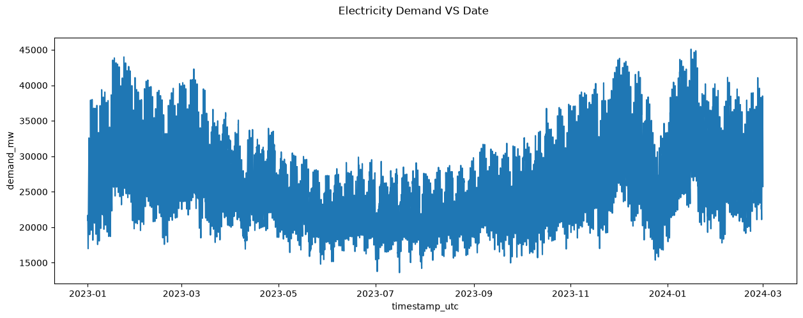
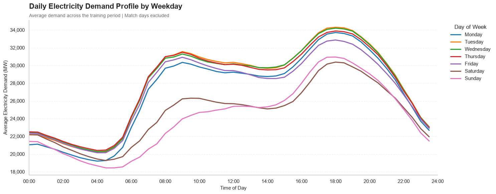
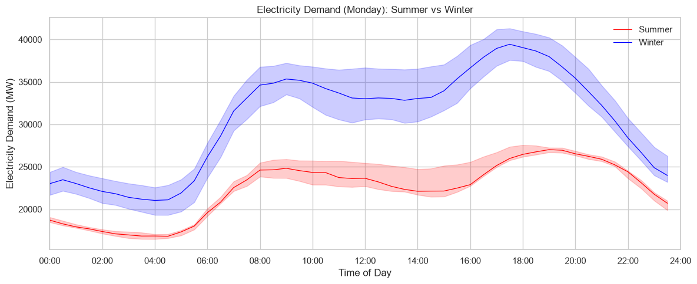
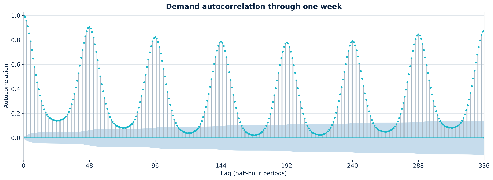
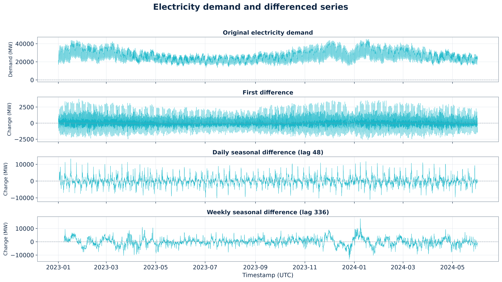
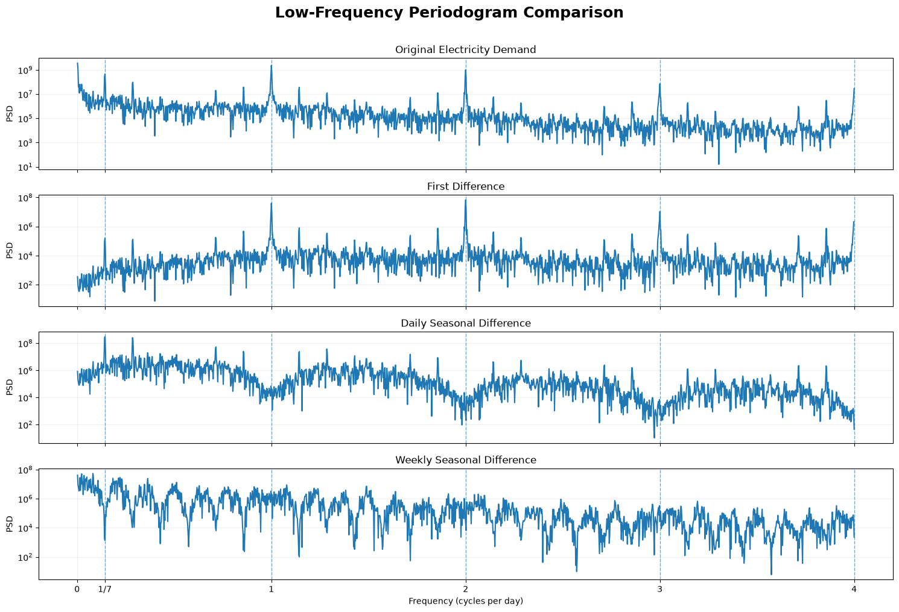
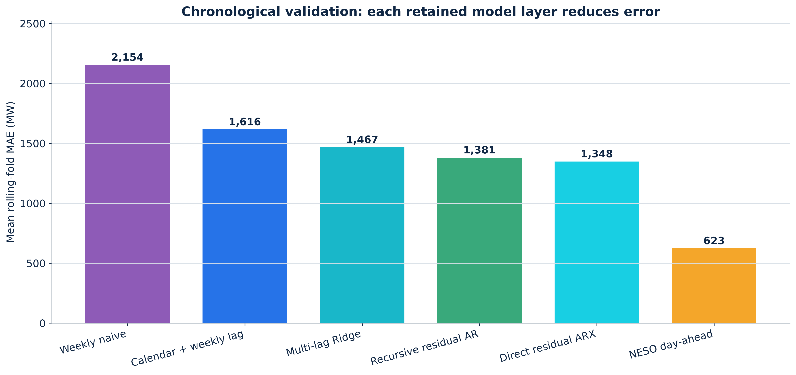
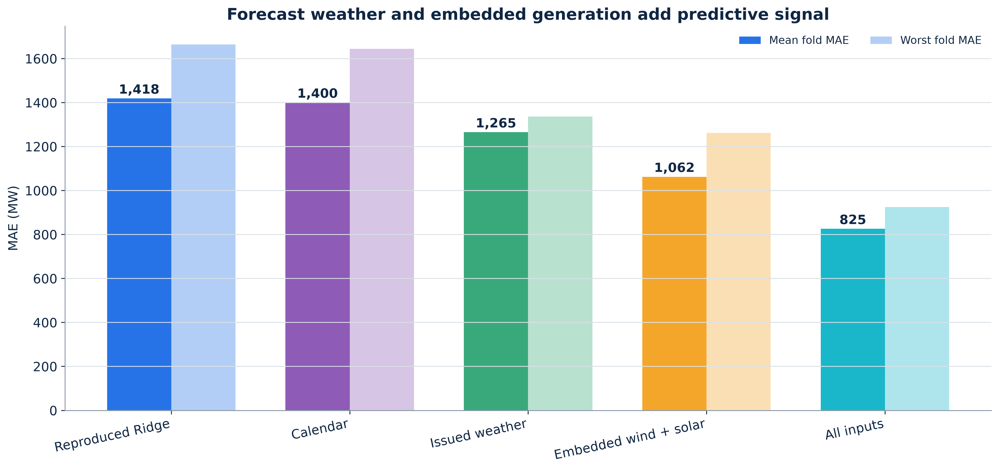
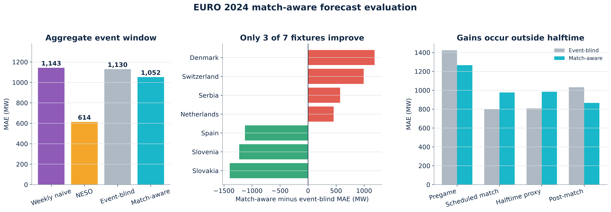

# The Halftime Effect: final slide explanation and presenter guide

This guide matches the approved **17-slide Canva presentation** titled *The Halftime Effect*.
It is designed for teammates who need to understand the work before presenting it. The wording is
a speaking guide, not a script that must be memorized.

- [Edit the presentation in Canva](https://www.canva.com/d/aExfppv4wytTxda)
- [View the presentation](https://www.canva.com/d/6u6uy0yAQ3kLzNI)
- [Verified model results](01_verified_model_results.md)
- [Model equations and inputs](05_model_equations.md)
- [Teacher question bank](04_teacher_question_bank.md)

## Essential terms used throughout the presentation

| Term | Simple meaning |
|---|---|
| Demand | Great Britain electricity demand outturn, measured in MW for each half-hour interval |
| Event-blind forecast | A forecast that does not know an England match is taking place |
| Match-aware forecast | The event-blind forecast plus adjustments based on scheduled match windows |
| Lag | A value observed a fixed number of half-hours earlier |
| MAE | Mean absolute error. It is the average size of the forecast errors. Lower is better |
| RMSE | Root mean squared error. It penalizes large errors more heavily than MAE |
| Mean error | Average of actual minus forecast. Positive means underforecasting; negative means overforecasting |
| Rolling-origin validation | Training on the past and validating on the next chronological period, repeated at several forecast origins |
| Leakage | Using information that would not have been available when the forecast was issued |
| Residual | Actual demand minus the model forecast; the part the model did not explain |

---

## Slide 1: The Halftime Effect

### What the slide shows

The title introduces the subject: forecasting half-hourly Great Britain electricity demand around
England football matches.

### Explanation

The original idea was that many viewers might use appliances at similar moments, especially around
halftime. A visible demand change alone cannot establish a football effect because demand changes
continually with clock time, weekday, season, weather, holidays and embedded generation. The project
therefore begins by forecasting normal demand and only then tests whether fixture information improves
that forecast.

### Suggested presentation wording

“We investigate whether the published timing of England football matches helps forecast Great Britain
electricity demand. We first model ordinary demand. We then test whether match timing explains any of
the remaining forecast error, with special attention to the halftime window.”

### Do not claim

Do not open by saying that football definitely causes an electricity spike. The project tests predictive
value and does not establish causality.

---

## Slide 2: Research question and study design

### What the slide shows

The project has two stages:

1. Forecast normal demand without match features.
2. Add scheduled match windows and test whether forecast errors decrease.

The research question is whether the published fixture schedule reduces next-day forecast error after
normal demand patterns have been modelled.

### Explanation

The first model is the counterfactual baseline: what demand would normally be expected to look like if
the model did not know about the match. The second model receives the same normal-demand inputs plus
fixture timing. The two forecasts are compared on identical timestamps. This isolates the *additional
predictive information* in the schedule.

### Main takeaway

The test is fair only if the event-blind baseline is credible. A weak baseline could mistake ordinary
weather or seasonal variation for a football signal.

### Suggested presentation wording

“We do not compare halftime demand with an arbitrary average. We first produce a day-ahead forecast of
normal demand, then ask whether adding fixture timing reduces the error on the same observations.”

---

## Slide 3: Why this is a difficult forecasting problem

### What the slide shows

The slide lists the major non-football drivers that the baseline must handle:

- 48 half-hour positions within a day
- weekday and weekend differences
- annual seasonality
- weather-related heating or cooling demand
- embedded wind and solar generation

These inputs feed a credible normal-demand baseline. Match features are assessed only after that.

### Explanation

The possible match signal is small compared with normal demand movement. Demand can change by many
thousands of MW during an ordinary day. A hot or cold day can also alter demand, while embedded solar
and wind can change the demand visible to the transmission system. If these factors remain unexplained,
the match correction may absorb them.

### Main takeaway

Building the event-blind model is not a separate side task. It is necessary for evaluating the match
schedule properly.

### Important distinction

Controlling major forecast drivers reduces confounding, but it does not turn this observational study
into a causal experiment. Unmeasured events can still influence demand.

---

## Slide 4: Data sources and target

### What the slide shows

The modelling panel combines one row per half-hour from five information groups:

| Information | Role in the project |
|---|---|
| GB demand | The target variable, `demand_mw` |
| Calendar | Time of day, weekday, season and holiday information |
| Issued weather forecasts | Forecast temperature and derived heating or cooling information known day ahead |
| Embedded generation forecasts | Wind and solar information affecting visible net demand |
| England fixtures | Scheduled kickoff and match-window information |

### Explanation

The target comes from NESO's half-hourly demand forecast-performance data. Each value is a power level
in **megawatts**, not energy in MWh and not an instantaneous kettle spike. The NESO operational demand
forecast is used as an external benchmark. It is not fed into the research models.

The weather inputs are archived forecasts issued before delivery, rather than realized target-day
weather. The fixture inputs also use published schedules rather than actual future outcomes.

### Main takeaway

Every predictor is timestamped so the project can check whether it would genuinely have been known at
the forecast cutoff.

### Likely question

**Why can embedded generation affect demand?** Distribution-connected solar and wind can supply some
local consumption before it reaches the transmission system. More embedded generation can therefore
lower the demand observed by NESO even if consumers use the same amount of electricity.

---

## Slide 5: Data preparation and leakage safeguards

### What the slide shows

The workflow contains five steps: align, validate, engineer, split and evaluate. The information boundary
states that each forecast is issued by 10:00 London time on the previous day.

### Explanation of each step

1. **Align:** create a continuous 30-minute UTC sequence. UTC gives every instant a unique identity,
   including daylight-saving transitions.
2. **Validate:** check missing intervals, duplicates, source record types and units.
3. **Engineer:** derive London calendar features and only use lagged values that already exist at the
   issue cutoff.
4. **Split:** keep observations in chronological order and use rolling training and validation periods.
5. **Evaluate:** score forecasts only using information available when the forecast would have been made.

### Why random splitting is prohibited

A random split would allow observations from later seasons and system conditions to help predict earlier
ones. It would also make closely neighbouring half-hours appear in both training and testing. That would
produce an unrealistically easy evaluation.

### Daylight-saving point

London clock-change days can contain 46 or 50 settlement intervals, while UTC remains a regular and
unique 30-minute sequence. UTC is used for ordering and elapsed lags; London time is used for human
calendar meaning.

---

## Slide 6: Demand follows a strong annual cycle

### How to read the plot

- The horizontal axis is chronological time.
- The vertical axis is half-hourly demand in MW.
- The dense vertical-looking movement comes from repeated intraday rises and falls compressed across a
  long time range.
- The overall level is generally higher in winter and lower in summer.

### Analysis

The plot provides evidence of annual seasonality and strong within-day variation. Winter demand can be
higher because of colder and darker conditions, while summer demand is generally lower. The series later
rises again, so the decline from winter into summer should not be described as a permanent downward trend.

The plot does not prove that the annual pattern will remain stable in every future year. The early EDA
contains only about one complete annual cycle plus additional months, so longer-term stability remains
uncertain.

### Modelling implication

The forecast needs to represent both the seasonal level and the repeated daily shape. One constant mean
cannot describe this series adequately.

### Suggested presentation wording

“The rapid oscillation is the repeated daily cycle. The slower winter-to-summer movement is consistent
with annual seasonality. We model both patterns instead of treating the series as having one fixed mean.”

---

## Slide 7: Daily shape changes by weekday and season

### Left plot: weekday profiles

Each line averages demand at the same London half-hour across one weekday. Working days show a strong
morning rise and a later peak. Weekend mornings rise less sharply, particularly on Sunday. In this
sample, the pooled mean profiles reach their maximum around the interval beginning at 18:00.

This means both **time of day** and **day of week** carry useful forecast information. It also explains
why a seven-day lag is more meaningful than a random past observation.

### Right plot: winter and summer Mondays

This comparison holds the weekday fixed and changes the season. Winter Monday demand remains above
summer Monday demand throughout the day in the sample. At 17:00, the medians are approximately 38,948 MW
in winter and 25,143 MW in summer. Winter peaks earlier and more strongly, while the summer curve is
flatter and peaks later.

The shaded regions are interquartile bands: the middle 50% of observations at each clock position. They
are not confidence intervals and not forecast intervals.

### Main takeaway

Season changes both the demand level and the shape of the day. A model needs interactions between annual
seasonality and within-week clock position, rather than only one fixed seasonal uplift.

### Do not claim

The plots do not isolate a causal effect of temperature, daylight or human behaviour. They describe the
combined pattern observed in the data.

---

## Slide 8: Autocorrelation reveals daily and weekly memory

### What autocorrelation means

Autocorrelation measures how strongly the current value is related to an earlier value of the same
series. A lag of 1 means 30 minutes earlier, lag 48 means 24 elapsed hours earlier, and lag 336 means
seven elapsed days earlier.

### How to read the plot

- Very high values near lag 0 show strong short-run persistence.
- Repeated peaks around 48, 96, 144 and later daily multiples show the daily cycle.
- The rise toward lag 336 shows additional weekly repetition.
- The shaded band is an approximate confidence band for zero autocorrelation. It is not a forecast
  interval for demand.

### Key values

| Lag | Time represented | Correlation | Forecasting interpretation |
|---:|---|---:|---|
| 1 | 30 minutes | 0.989 | Strong dependence, but tomorrow's preceding actual value is unavailable today |
| 48 | 24 hours | 0.914 | Strong daily repetition, but some target-day lags are unavailable at issue time |
| 336 | 7 days | 0.893 | Strong weekly repetition and safely known at the day-ahead cutoff |

### Why lag 336 becomes the benchmark

The weekly seasonal-naive forecast is `forecast(t) = demand(t - 336)`. It needs no fitted coefficients,
usually aligns the weekday, and uses information genuinely available one week earlier. More complicated
models should beat this meaningful baseline.

### Important caution

Many lags are statistically significant because the raw series contains strong deterministic seasonality
and the sample is large. Significant ACF stems should not be converted mechanically into hundreds of AR
terms.

---

## Slide 9: Differencing reduces non-stationarity

### What the four panels show

1. **Original demand:** strong changing seasonal level and repeated cycles.
2. **First difference:** change from the immediately previous half-hour.
3. **Daily seasonal difference:** difference from 48 half-hours earlier.
4. **Weekly seasonal difference:** difference from 336 half-hours earlier.

### Why differencing is used

Differencing removes a comparison level and can make the local mean more stable. First differencing
removes much of the slow movement by focusing on adjacent changes. Daily differencing compares a clock
position with the previous day. Weekly differencing compares it with the preceding week.

### Formal test results

- Raw demand: ADF p-value = 0.343, so ADF does not reject its unit-root null.
- Raw demand: Phillips–Perron p-value < 0.001, so PP rejects its unit-root null.
- For the differenced series, both tests reject the unit-root null.

### Correct interpretation

The two raw-series tests disagree, so the presentation should not claim that one test conclusively proves
raw demand is or is not stationary. Differencing improves mean stability, but visible seasonal dependence
and changing variance remain. Rejecting a unit root does not prove white noise, constant variance or no
seasonality.

### Suggested presentation wording

“Differencing makes the series more stable around zero, and the formal tests reject a unit root after
transformation. However, transformation does not remove all temporal structure, so modelling is still
required.”

---

## Slide 10: Spectral analysis confirms daily and weekly cycles

### What spectral analysis does

The ACF studies repetition using time lags. A periodogram studies the same series in the frequency domain.
Frequency tells us how often a cycle repeats. Period is the reciprocal of frequency.

### How to interpret the important peaks

- A frequency near **1 cycle per day** corresponds to a 24-hour cycle, or 48 half-hours.
- A frequency near **1/7 cycle per day** corresponds to a seven-day cycle, or 336 half-hours.
- Peaks near 2, 3 and 4 cycles per day are daily harmonics. They arise because the daily profile is not a
  perfect sine wave.

### What the transformed spectra show

First differencing greatly reduces low-frequency power. Daily differencing suppresses frequencies aligned
with the daily cycle, creating notches at daily harmonics. Weekly differencing suppresses frequencies
aligned with seven-day repetition. None of the spectra becomes flat, so none of these transformations
alone produces white noise.

### Main takeaway

The frequency-domain evidence supports the daily and weekly cycles already seen in the EDA and ACF. This
justifies seasonal features and lag structures in the forecasting models.

### Do not claim

A periodogram peak identifies a recurring frequency, not the behavioural cause of that pattern.

---

## Slide 11: Chronological forecasting protocol

### What the slide shows

The evaluation moves forward in time:

1. Train on historical observations.
2. Tune model choices on earlier rolling validation periods.
3. Lock the specification.
4. Evaluate on calendar year 2025.
5. Review January to March 2026 retrospectively.

### Explanation

Every target day is forecast from an issue cutoff at 10:00 London time on the preceding day. The model
cannot use realized demand, weather or generation from the target day. Rolling-origin validation repeats
the realistic process of learning from the past and forecasting a later period.

### Why 2025 and 2026 have different labels

Calendar year 2025 is the locked test for the selected model. January to March 2026 had already been
opened during earlier experimentation, so it cannot honestly be called a new untouched holdout. It is
reported as retrospective evidence.

### Main takeaway

The protocol protects against selecting a model because it happens to fit one convenient future period.

---

## Slide 12: Linear time-series models improve the weekly benchmark

### How to read the plot

The vertical axis is mean MAE across four chronological validation folds. Lower bars indicate more
accurate forecasts. Every project model is tested on the same folds.

| Model | Mean validation MAE | What changes |
|---|---:|---|
| Weekly seasonal naive | 2,154 MW | Copies demand from one week earlier |
| Calendar plus weekly lag | 1,616 MW | Adds normal weekly and annual calendar structure |
| Multi-lag Ridge | 1,467 MW | Adds several leakage-safe demand lags and regularization |
| Ridge plus recursive residual AR | 1,381 MW | Forecasts remaining error recursively from past residuals |
| Ridge plus direct residual ARX | **1,348 MW** | Forecasts each horizon's residual directly using cutoff-known inputs |
| NESO day-ahead | 623 MW | External operational benchmark, not trained by this project |

### Analysis

The weekly benchmark captures repetition but misses changing levels. Calendar and lagged-demand regression
substantially reduce that error. Ridge helps when many related lag and calendar variables are used because
it shrinks correlated coefficients. Residual models improve the forecast further by modelling structure
left in the errors.

Direct residual ARX is the best retained V2 project model in this four-fold comparison. Its mean MAE is
about 37% lower than weekly naive, although NESO remains much more accurate.

### Important caution

The chart documents model development. It does not mean each method was tested on a completely new final
test. Model selection occurs on chronological development folds, followed by locked evaluation.

---

## Slide 13: Forecast weather and embedded generation add signal

### How to read the plot

For each Ridge feature family, the darker bar is mean validation MAE and the lighter bar is the worst-fold
MAE. Lower values are better. A low worst-fold score indicates that a model is not relying on one unusually
easy period.

| Ridge feature family | Mean MAE | Worst-fold MAE |
|---|---:|---:|
| Reproduced demand-lag Ridge | 1,418 MW | 1,664 MW |
| Rich calendar | 1,400 MW | 1,644 MW |
| Issued weather forecasts | 1,265 MW | 1,336 MW |
| Embedded wind and solar forecasts | 1,062 MW | 1,262 MW |
| All exogenous inputs | **825 MW** | **925 MW** |

### What an ablation comparison means here

The underlying plain Ridge framework stays fixed while the available information changes. The calendar,
weather and embedded-generation bars are feature-family comparisons against the reproduced base. They
should not be described as a single sequential pipeline in which each bar automatically includes the bar
before it. The final “all inputs” model combines the information groups.

### Analysis

Richer calendar details provide a small improvement. Archived issued weather forecasts provide a clearer
gain. Embedded wind and solar provide an even larger gain because the target is demand visible to the
transmission system. Combining all inputs gives the best result and also sharply reduces the worst-fold
error.

### Information-boundary point

These are issued forecasts available day ahead. Using realized future weather or generation would leak
target-day information and make the result invalid.

---

## Slide 14: Residual dynamics: direct, recursive and ARMA

### What the slide shows

All three methods begin with the same exogenous Ridge forecast and model the remaining residuals. The
numbers are mean MAE across the corrected seven-fold development comparison.

### Recursive residual AR

The recursive model predicts the next residual from earlier residual lags. For later target intervals, it
feeds its own predicted residuals back into the model. The retained recursive candidates reach about
777 MW MAE. This is compact and effective, but forecast errors can propagate through the recursion.

### Direct residual ARX Ridge

The direct model creates a separate correction for each target horizon from information known at the
cutoff: safe residual lags, recent residual summaries, horizon, clock, weekday, the base forecast, weather,
holidays and embedded generation. It does not require tomorrow's earlier realized residuals. It achieves
**750 MW MAE**, the best development result, so it is selected.

### ARMA residual models

ARMA combines autoregressive terms, which use earlier residuals, with moving-average terms, which use
earlier innovations. ARMA(1,1), ARMA(2,1) and ARMA(2,2) score between 802 and 818 MW MAE. They improve the
plain Ridge model but do not beat direct ARX.

### Why selection uses development validation

The project selects direct ARX because it wins before the locked evaluation is examined. A different model
may happen to score slightly better on a later period, but changing the choice afterward would be
test-set overfitting.

### One-sentence comparison

“Recursive AR forecasts errors step by step, ARMA models residuals and past shocks recursively, while
direct ARX maps cutoff-known information directly to each forecast horizon.”

---

## Slide 15: Final evaluation across two periods

### What the slide shows

The left panel reports the locked calendar-year 2025 test. The right panel reports the January to March
2026 retrospective comparison.

### Locked 2025 test

| Forecast | MAE |
|---|---:|
| Weekly naive | 3,101 MW |
| V2 Ridge plus direct residual ARX | 1,622 MW |
| NESO day-ahead | 781 MW |

The selected V2 model reduces MAE by 47.7% relative to weekly naive. This shows substantial improvement
over a simple seasonal rule, while the external NESO forecast remains stronger.

### Retrospective January to March 2026 evidence

| Forecast | MAE |
|---|---:|
| Weekly naive | 2,464 MW |
| Plain exogenous Ridge | 1,005 MW |
| Ridge plus ARMA(1,1) | 970 MW |
| Ridge plus direct residual ARX | 931 MW |
| Ridge plus recursive AR | **918 MW** |
| NESO day-ahead | **807 MW** |

Recursive AR happens to beat direct ARX by 13 MW on this later period. The selected specification remains
direct ARX because it won development validation. This is an example of correct model-selection discipline.

### Two comparison cautions

1. Do not directly interpret 1,622 MW in 2025 and 931 MW in 2026 as improvement caused only by the model.
   The periods and model scopes differ.
2. NESO has 4,222 available rows in the 2026 comparison, while the project models have 4,318. The NESO
   comparison is informative but not perfectly row-identical.

---

## Slide 16: Match timing helps overall, but not at halftime

### Left panel: aggregate event-window accuracy

| Forecast | MAE |
|---|---:|
| Weekly naive | 1,143 MW |
| NESO day-ahead | 614 MW |
| Event-blind model | 1,130 MW |
| Match-aware model | **1,052 MW** |

Adding scheduled match windows improves the aggregate event-window MAE by 78 MW relative to the
event-blind forecast. This establishes some predictive association in the combined window.

### Middle panel: result by fixture

The horizontal bars show match-aware MAE minus event-blind MAE. A negative bar means the match-aware
model improved the fixture; a positive bar means it became worse. Only **three of seven** fixtures improve.
This instability matters: one aggregate average can hide inconsistent match-level behaviour.

### Right panel: result by match window

| Window | Event-blind MAE | Match-aware MAE | Change |
|---|---:|---:|---|
| Pregame | 1,424 MW | 1,265 MW | 158 MW better after rounding |
| Scheduled play | 799 MW | 976 MW | 177 MW worse |
| Halftime proxy | 808 MW | 984 MW | **176 MW worse** |
| Post-match | 1,032 MW | 866 MW | 166 MW better |

The aggregate improvement comes from pregame and post-match intervals. Performance worsens during the
scheduled-play and halftime-proxy windows. Therefore, this is **not** evidence of a reliable halftime-aware
forecast.

### Why “halftime proxy” is used

The data use scheduled kickoff and approximate windows rather than verified whistle times. A half-hour
observation also cannot isolate a brief television-pickup spike lasting only a few minutes.

### Statistical and causal limitation

Seven fixtures are a very small event sample. Only three improve, and the fixture-bootstrap interval for
the mean change crosses zero widely. The result should be described as predictive association, not proof
that football caused a particular MW change.

### Recommended wording

“Known match timing improves the combined event window, but the gain is inconsistent across fixtures and
does not occur at halftime. Our verified evidence therefore does not isolate a robust halftime effect.”

---

## Slide 17: Conclusions, limitations and next study

### What the slide shows

The project ends with three supported conclusions:

1. A strong calendar-and-lag baseline is necessary before testing football features.
2. Issued weather, embedded generation and residual models add verified forecasting value.
3. Match timing provides some aggregate predictive value, but the study does not establish causality or
   a distinct halftime effect.

### Limitations

- Only seven EURO 2024 England fixtures form the main tournament evaluation.
- Scheduled windows approximate actual halftime and full-time.
- Half-hour data cannot resolve a brief pickup lasting a few minutes.
- The electricity system and forecast relationships can change over time.
- Weather and generation forecasts contain their own errors.
- Other events and omitted variables can confound an observational match comparison.

### Proposed next study

Pre-register event windows and evaluation metrics before viewing outcomes. Add more tournament editions
and verified actual match timings. Report uncertainty intervals and investigate whether effects vary by
kickoff time, tournament stage or audience size. Keep a future tournament completely untouched until the
model and analysis rules have been locked.

### Recommended closing statement

“The project produced a much stronger, leakage-safe day-ahead demand model. Scheduled match timing gave a
small aggregate improvement on EURO 2024, but the improvement was inconsistent and halftime performance
worsened. The honest conclusion is that we did not verify a robust halftime-specific effect.”

---

## Rules every presenter should follow

1. Say **predictive association**, not causal effect.
2. Say **half-hour demand in MW**, not energy in MWh or an instantaneous spike.
3. Say **scheduled halftime proxy**, not exact halftime, unless actual whistle data are added.
4. Keep development validation, locked 2025 testing and retrospective 2026 evidence separate.
5. Remember that lower MAE and RMSE are better.
6. Explain that the NESO forecast is an external benchmark, not an input or a model trained by the group.
7. Do not hide the negative halftime result. It is one of the project's most important findings.
8. If unsure about a number, refer to [the verified result tables](01_verified_model_results.md) rather
   than estimating from a chart.

## Suggested handover to teammates

Each teammate should first read the sections for their assigned slides, then read the essential terms at
the beginning and the rules above. They should be able to explain the main takeaway without reading the
slide text. For model-heavy slides 12 to 15, use [the equation guide](05_model_equations.md). For possible
teacher questions, use [the question bank](04_teacher_question_bank.md).
