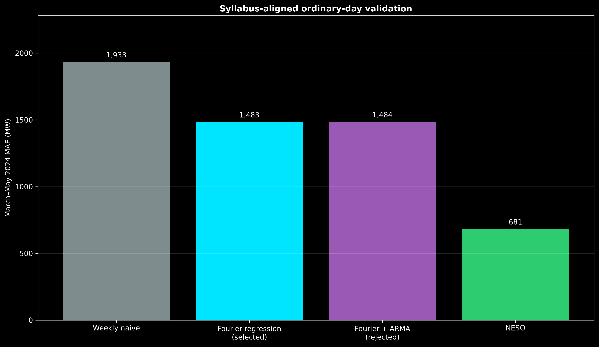
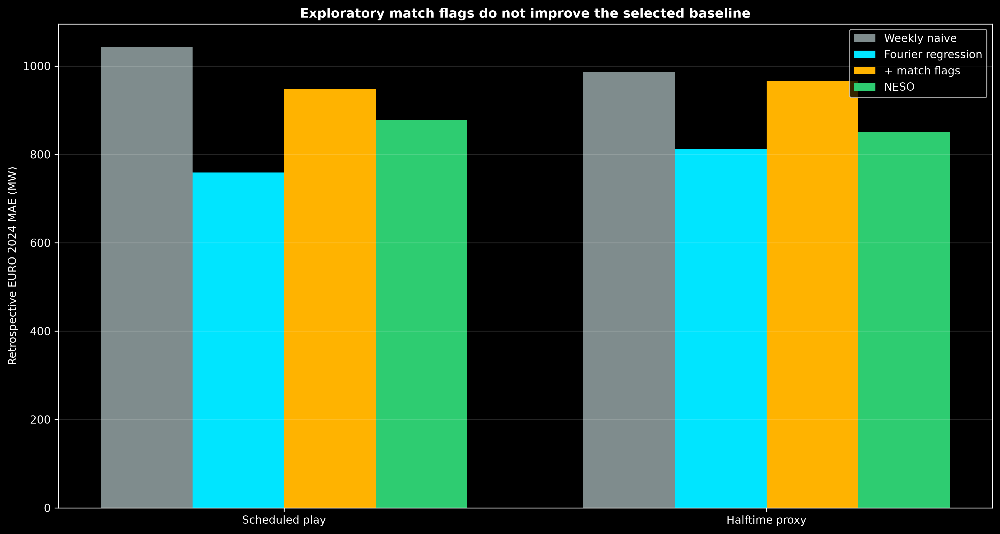

# Syllabus-aligned final forecasting analysis

This is the presentation-facing source of truth. It deliberately restricts the project
to methods named in the supplied course specification.

## Models used

1. **Weekly seasonal naive:** `forecast at t = demand at t − 336 half-hours`.
2. **Seasonal regression with Fourier terms:** the selected statistical model.
3. **Fourier regression with ARMA(2,1) errors:** attempted and rejected because it
   slightly worsened validation accuracy.
4. **Fourier regression plus scheduled-match and halftime flags:** exploratory only,
   because only five usable pre-EURO-2024 tournament matches were available.

The selected model is:

```text
demand = trend
       + weekly Fourier seasonality
       + annual Fourier seasonality
       + holiday terms
       + issued temperature forecast terms
       + issued embedded wind and solar forecast terms
       + error
```

No additional advanced forecasting methods are part of this final analysis.

## Data separation

| Purpose | Dates | Use |
|---|---|---|
| Ordinary model fitting | 1 April 2021 – 28 February 2024 | Estimate regression and ARMA parameters |
| Ordinary validation | 1 March – 31 May 2024 | Select between the syllabus models |
| Match-flag training | Five World Cup 2022 England matches | Exploratory scheduled-match coefficients |
| EURO 2024 | Seven England matches | Previously opened retrospective comparison |

EURO 2020 is not used to estimate match flags. Only about ten weeks of demand history
exist before that edition, which is insufficient to estimate annual Fourier seasonality
without unstable extrapolation.

## Ordinary validation results

| Forecast | MAE | RMSE | Mean error: actual − forecast |
|---|---:|---:|---:|
| Weekly seasonal naive | 1,933 MW | 2,526 MW | −635 MW |
| **Fourier seasonal regression** | **1,483 MW** | **1,833 MW** | +1,120 MW |
| Fourier regression + ARMA(2,1) errors | 1,484 MW | 1,834 MW | +1,121 MW |
| NESO day-ahead | 681 MW | 914 MW | −58 MW |

The Fourier regression improves substantially over weekly naive. ARMA converges, but
changes the forecast very little and worsens MAE by approximately 1 MW. The simpler
Fourier regression is therefore selected.



## EURO 2024 retrospective result

| Window and forecast | MAE |
|---|---:|
| Scheduled play — weekly naive | 1,043 MW |
| Scheduled play — **Fourier regression** | **759 MW** |
| Scheduled play — exploratory match flags | 948 MW |
| Scheduled play — NESO | 878 MW |
| Halftime — weekly naive | 987 MW |
| Halftime — **Fourier regression** | **812 MW** |
| Halftime — exploratory match flags | 967 MW |
| Halftime — NESO | 850 MW |

The match-aware coefficients learned from five World Cup matches are approximately:

```text
scheduled-play coefficient = +472 MW
additional halftime coefficient = −398 MW
full-halftime net correction = +74 MW
```

They worsen EURO 2024 forecasts. The defensible conclusion is therefore to retain the
event-blind Fourier regression and treat the match-aware forecast as an unsuccessful
exploratory extension.



## ARCH/GARCH decision

The ARCH-LM test strongly rejects constant conditional variance. This satisfies the
course requirement to diagnose ARCH behavior. GARCH is not included in the final model:
it does not alter the point forecast, and earlier diagnostic fits produced intervals
that were too narrow on later data. Adding it would increase presentation complexity
without strengthening the central forecasting conclusion.

## Final conclusion

- The selected model is seasonal regression with Fourier terms and issued exogenous
  forecasts.
- ARMA(2,1) was tried and rejected on validation performance.
- Match flags were tried and worsened the seven-match retrospective result.
- The project makes no causal claim about football.
- NESO remains the operational benchmark, although the project model happens to be
  more accurate within these small EURO 2024 scheduled-play and halftime samples.

## Reproduction

```bash
.venv/bin/python src/build_forecast_dataset.py
.venv/bin/python src/evaluate_syllabus_aligned_models.py
.venv/bin/python src/plot_syllabus_aligned_results.py
.venv/bin/python -m unittest discover -s tests -v
```
